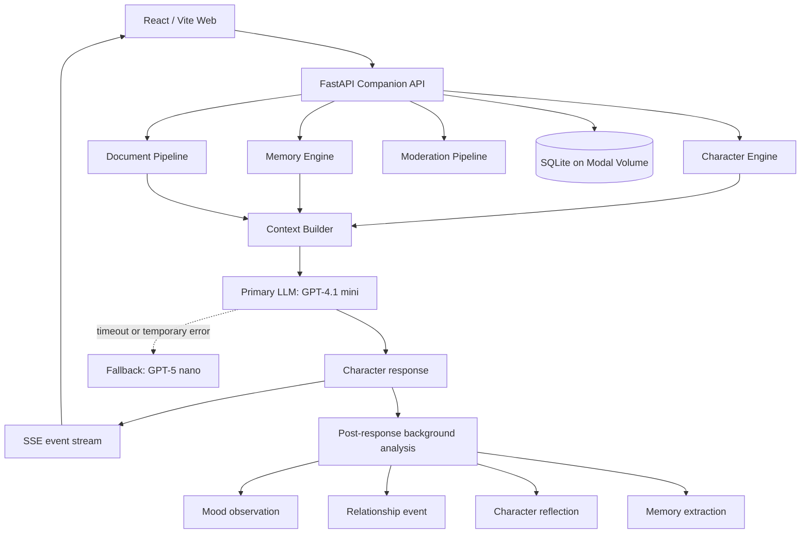
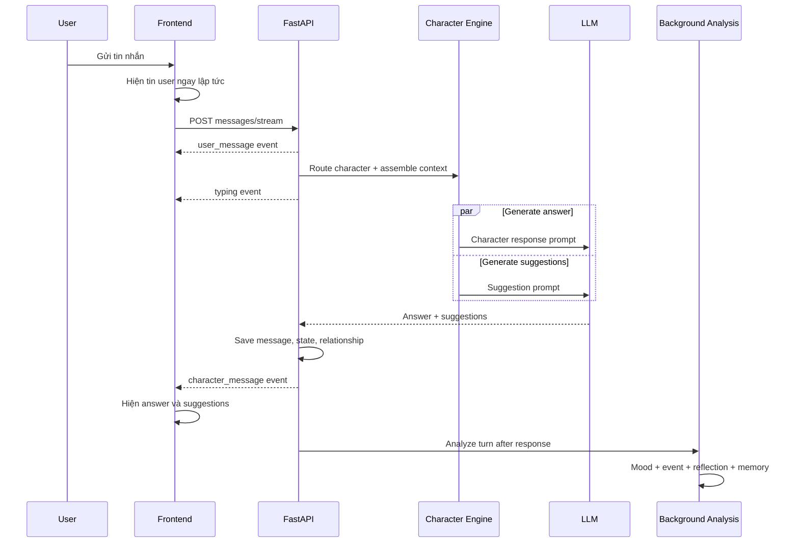
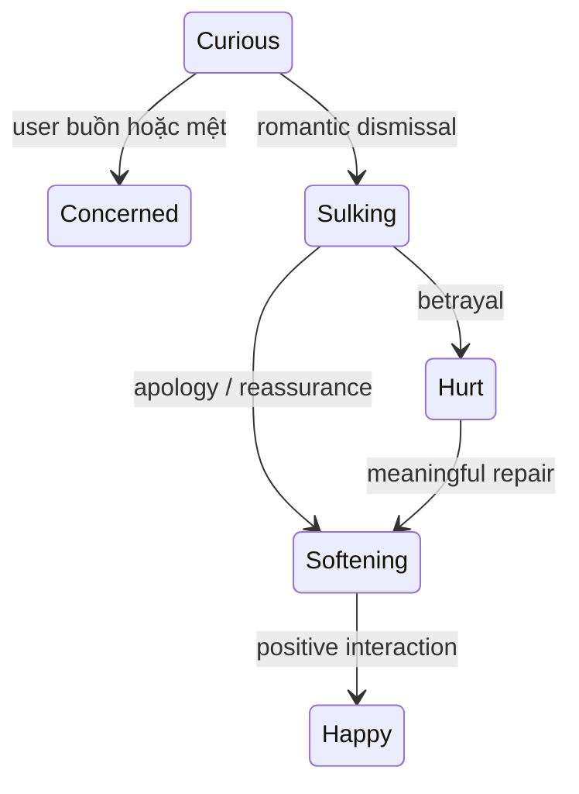

# Phiên bản ver1

Bản này không có companion video. Hướng dẫn Git, đóng gói ZIP và deploy: [RELEASE_VERSIONS.md](docs/RELEASE_VERSIONS.md).

# Character Chat

Tài liệu kiến trúc, API, database, AI pipeline, Modal, open source, bảo mật và vận hành: [docs/ARCHITECTURE_AND_ENGINEERING_GUIDE.md](docs/ARCHITECTURE_AND_ENGINEERING_GUIDE.md).

Character Chat là demo SaaS companion AI và roleplay nhân vật. Backend dùng FastAPI, frontend dùng React/Vite, dữ liệu production nằm trong SQLite trên Modal Volume và LLM được gọi qua AVIBI.

**Production:** <https://nguyenthanhcongloi332004--character-chat-web.modal.run/>

## Mục lục

1. [Khởi động nhanh](#1-khởi-động-nhanh)
2. [Kiến trúc hệ thống](#2-kiến-trúc-hệ-thống)
3. [Character Engine](#3-character-engine)
4. [Workflow một lượt chat](#4-workflow-một-lượt-chat)
5. [Relationship và emotion](#5-relationship-và-emotion)
6. [Memory, reflection và mood](#6-memory-reflection-và-mood)
7. [Tài liệu và tri thức](#7-tài-liệu-và-tri-thức)
8. [Group chat](#8-group-chat)
9. [Suggestion](#9-suggestion)
10. [Kiểm duyệt nội dung](#10-kiểm-duyệt-nội-dung)
11. [Dữ liệu, tài khoản và mật khẩu](#11-dữ-liệu-tài-khoản-và-mật-khẩu)
12. [Toàn bộ lệnh Terminal](#12-toàn-bộ-lệnh-terminal)
13. [Deploy production](#13-deploy-production)
14. [Chạy local và kiểm thử](#14-chạy-local-và-kiểm-thử)
15. [API và debug](#15-api-và-debug)
16. [Xử lý lỗi thường gặp](#16-xử-lý-lỗi-thường-gặp)
17. [Giới hạn trước khi thành SaaS thật](#17-giới-hạn-trước-khi-thành-saas-thật)
18. [Tự chỉnh voice tự phát và suggest trong code](#18-tự-chỉnh-voice-tự-phát-và-suggest-trong-code)

## 1. Khởi động nhanh

Mở VS Code, chọn **Terminal → New Terminal**, rồi chạy:

```powershell
cd D:\ai_chat_char
$env:PYTHONUTF8="1"
python -m modal deploy modal_app.py
```

Khi thấy `App deployed`, mở URL production và nhấn `Ctrl + F5` để bỏ cache frontend cũ.

Deploy code không xóa database, Modal Volume hoặc Modal Secret. Nếu các secret vẫn tồn tại thì không cần nhập lại API key.

## 2. Kiến trúc hệ thống



### Thành phần

| Thành phần           | File chính                     | Trách nhiệm                                               |
| -------------------- | ------------------------------ | --------------------------------------------------------- |
| API và orchestration | `character_chat/main.py`       | Endpoint, phòng chat, streaming, CRUD và background task  |
| Character Engine     | `character_chat/engine.py`     | LLM client, routing, state, relationship, prompt assembly |
| System prompts       | `character_chat/prompts.py`    | Prompt trả lời, suggestion và Character Compiler          |
| Preset characters    | `character_chat/presets.py`    | CharacterSpec và prompt riêng của từng preset             |
| Database             | `character_chat/db.py`         | SQLAlchemy models và SQLite connection                    |
| Memory/Retrieval     | `character_chat/retrieval.py`  | Chunking, lexical retrieval, memory scoring               |
| Background agents    | `character_chat/background.py` | Mood, relationship event, reflection và LLM memory        |
| Documents            | `character_chat/documents.py`  | PDF, DOCX, PPTX, TXT, MD, CSV, XLSX parsing               |
| Moderation           | `character_chat/moderation.py` | Keyword, OpenAI Moderation và contextual classifier       |
| Frontend             | `frontend/src/main.tsx`        | UI, chat, upload, SSE, typing, suggestion                 |
| Modal deployment     | `modal_app.py`                 | Build frontend, image, secrets, volume và ASGI app        |

## 3. Character Engine

Mỗi nhân vật là một `CharacterSpec`, không chỉ là một câu “Bạn là nhân vật X”. Spec gồm:

```text
Identity
Personality scores
Speech style
Support profile
System prompt riêng
Scenario
Initial greeting
Dialogue examples
Goals và behavior rules
Persona knowledge
Memory policy
```

### Immutable core và mutable overlay

Character Engine tách nhân vật thành hai lớp:

**Immutable core** giữ những nét không được trôi theo thời gian:

- Identity và role.
- Temperament.
- Giá trị và ranh giới.
- Cách xưng hô, độ dài câu, mức trang trọng.
- Nét đặc trưng như lạnh lùng, bí ẩn, vui tính hoặc ấm áp.

**Mutable overlay** thay đổi theo quan hệ và tình huống:

- Familiarity.
- Trust.
- Affinity.
- Tension.
- Respect.
- Openness.
- Current emotion.
- Energy.
- Private reflections.

Ví dụ Duy có thể ngày càng quan tâm và cởi mở, nhưng vẫn điềm tĩnh, ngắn gọn và quyết đoán. Mutable overlay không được phép biến Duy thành một trợ lý tư vấn chung chung.

### Character Prompt Compiler

Nhân vật user tạo được xử lý theo workflow:

```text
Thông tin user nhập
    ↓
CHARACTER_COMPILER_SYSTEM_PROMPT
    ↓
LLM tạo CharacterSpec có cấu trúc
    ↓
Pydantic kiểm tra schema
    ↓
Lưu Character + CharacterVersion
```

Compiler giữ nguyên tên, vai trò, mô tả, scenario, greeting và dialogue examples do user cung cấp. Nó chỉ suy luận phần thiếu và phải xác định immutable traits cùng relationship-dependent traits.

### Prompt layers

Context Builder ghép prompt theo thứ tự:

```text
Global safety
Core character prompt
Identity + personality + speech
Scenario
Support profile
Relationship stage
Character emotion
User mood signal
Daily tasks khi liên quan
Persona knowledge
Relevant memories
Private reflections
Relationship events
Room documents
Retrieved document chunks
Style examples
Dialogue examples
Recent conversation
Post-history voice lock
Latest user message
```

Các layer như mood, reflection, document và memory chỉ được chèn khi có dữ liệu phù hợp.

### Character Voice Lock

Hệ thống dùng hai lớp chống mất vai:

1. Voice Lock trong system prompt yêu cầu mọi câu trả lời phải giữ role, temperament, vocabulary, mannerism và relationship pace.
2. Post-History Voice Lock được đặt sau lịch sử và ngay trước user message cuối, giúp lịch sử dài không lấn át CharacterSpec.

Lịch sử assistant chỉ được dùng để giữ continuity. Nếu một câu cũ có giọng nhạt hoặc chung chung, model phải theo character card và dialogue examples.

## 4. Workflow một lượt chat



Frontend thêm tin user bằng `flushSync` trước khi gọi API. Chat 1-1 và group đều có typing dots. Trong group, mỗi character hoàn thành sẽ được đưa lên ngay, không cần chờ tất cả.

Primary model là `openai/gpt-4.1-mini`. Khi timeout, lỗi mạng, HTTP 408/429/5xx, engine thử lại bằng `zenlayer/gpt-5-nano`.

## 5. Relationship và emotion

### Relationship scores

```json
{
  "familiarity": 0.42,
  "trust": 0.51,
  "affinity": 0.47,
  "tension": 0.08,
  "respect": 0.39
}
```

Quy tắc hiện tại:

- Mỗi lượt làm familiarity tăng, nhưng tốc độ chậm dần khi đã rất thân.
- Chia sẻ cá nhân làm trust tăng.
- Cảm ơn, yêu quý và tương tác tích cực làm affinity tăng.
- Lạnh nhạt, xúc phạm hoặc phản bội làm tension tăng.
- Xin lỗi và dỗ dành làm tension giảm, trust/affinity phục hồi.
- Mọi giá trị bị giới hạn trong khoảng `0..1`.

### Sáu cấp quan hệ

```text
Mới gặp
→ Đã làm quen
→ Quen thuộc
→ Tin tưởng
→ Thân thiết
→ Gắn bó sâu sắc
```

Stage chỉ thay đổi cách thể hiện. Nó không thay đổi immutable core.

### Character emotion state machine

Các state chính gồm:

```text
curious, concerned, happy, gentle,
slightly_annoyed, sulking, hurt, softening
```

Ví dụ transition:



Cảm xúc có quán tính, không bị thay ngay bởi một câu hỏi bình thường. Intensity giảm khi user offline lâu.

### Energy

- Mỗi lượt chat làm energy giảm nhẹ tùy độ dài tin nhắn.
- Tin vui có thể tăng nhẹ energy.
- Energy hồi phục theo số giờ offline.
- Energy chỉ điều chỉnh độ hoạt náo và cách thể hiện, không được dùng để gây khó chịu hoặc từ chối user vô lý.

### User affect và character emotion là hai dữ liệu khác nhau

`detect_user_affect` ước lượng nhanh cảm xúc user trong request chính. Background Nano classifier phân tích sâu hơn và xác định cảm xúc có hướng vào character không.

Ví dụ:

- “Tôi đang bực sếp” không làm Mia giận user.
- “Tôi đang bực bạn” có thể tạo relationship event hướng vào Mia.

## 6. Memory, reflection và mood

### Các loại memory

| Visibility          | Ý nghĩa                                   |
| ------------------- | ----------------------------------------- |
| `USER_GLOBAL`       | Dùng cho user ở mọi nơi                   |
| `CHARACTER_PRIVATE` | Chỉ character đó được dùng                |
| `ROOM_SHARED`       | Chỉ các character trong room đó được dùng |

Memory retrieval sử dụng:

```text
lexical similarity
+ importance
+ recency
+ emotional/type weight
+ pinned boost
```

Memory trùng nội dung hoặc quá giống sẽ được gộp thay vì tạo bản mới. User có API để xem, sửa, ghim và xóa memory.

### Background analysis

Sau khi response đã gửi, `zenlayer/gpt-5-nano` phân tích structured JSON:

```json
{
  "user_emotion": "apologetic",
  "valence": 0.3,
  "arousal": 0.2,
  "confidence": 0.9,
  "directed_at_character": true,
  "relationship_event": "repair",
  "event_valence": 0.7,
  "significance": 0.8,
  "reflection": "The user made a sincere effort to repair tension.",
  "memory_worthy": true,
  "memory_summary": "User values repairing conflict sincerely."
}
```

Chỉ mood, event và memory đủ confidence mới được lưu. Lỗi background analysis không làm hỏng hoặc trì hoãn câu trả lời chat.

### Character reflection

Reflection là suy nghĩ riêng dùng cho continuity, không hiển thị cho user và không được quote trong câu trả lời. Reflection tương tự sẽ được deduplicate. Reflection chỉ điều chỉnh hành vi tương lai; không được sửa immutable core hoặc bịa sự kiện.

## 7. Tài liệu và tri thức

Hệ thống có hai pipeline độc lập.

### Tài liệu gửi trong phòng chat

```text
User chọn file trong composer
→ thẻ file hiện ngay trong chat
→ upload /v1/rooms/{room_id}/knowledge
→ parse và moderation
→ chia chunk
→ tạo LLM overview
→ gắn RoomDocument
→ mọi AI trong đúng room có thể truy xuất
```

- File hiện `Đang gửi…`, `Đã gửi` hoặc thẻ đỏ `Lỗi!`.
- File tồn tại cùng room và được xóa khi room bị xóa.
- Không đưa file vào thư viện tài liệu chung.
- Không thay đổi personality của character.
- AI luôn nhận danh sách file của room; câu “tóm tắt tài liệu” vẫn kích hoạt retrieval dù không trùng từ trong file.

### Tài liệu dùng để tạo nhân vật

```text
Upload /v1/character-sources
→ parse + moderation + chunks
→ discover characters
→ user chọn character và cutoff
→ LLM compile CharacterSpec
→ đưa backstory/personality/speech vào character
→ xóa file và chunks tạm
```

Pipeline này tạo tính cách nhân vật. Nó không trở thành knowledge file trong room.

### Định dạng

```text
PDF, DOCX, PPTX, TXT, MD, CSV, XLSX
Tối đa 10 MB
```

Retrieval hiện dùng lexical cosine trên word counts và threshold. Đây chưa phải embedding/pgvector thực sự.

## 8. Group chat

- Mỗi room chứa từ một đến nhiều character.
- Mỗi character chỉ thấy user messages và câu trả lời trước đó của chính mình.
- Character không dùng câu trả lời của AI khác làm input, tránh ảnh hưởng tính cách.
- `@Tên` chỉ định đúng character trả lời.
- `speaker_mode=everyone` yêu cầu tất cả character trả lời.
- `speaker_mode=character:<id>` chọn thủ công một character.
- `auto` chấm điểm theo role, goals, empathy, humor và nội dung user.
- Nếu hai character quá gần điểm, LLM director có thể chọn tối đa hai người.
- Mỗi response được stream thành event riêng.

## 9. Suggestion

Answer và suggestions chạy song song. Suggestion chỉ dựa vào user message mới nhất và character identity, không cần chờ answer.

Format nội bộ:

```text
@@message 1|message 2|message 3
```

Ba suggestion phải:

- Là tin nhắn đứng từ phía user.
- Cùng ngôn ngữ và cách xưng hô với user.
- Ngắn, liên quan và đa dạng.
- Không phải câu character hỏi ngược user.
- Click vào sẽ gửi ngay.
- Chỉ suggestions của response mới nhất được hiển thị.

Parser chặn các mẫu assistant-to-user phổ biến. Nếu model trả sai format, hệ thống dùng fallback phía user.

## 10. Kiểm duyệt nội dung

Pipeline áp dụng khi tạo character và xử lý tài liệu:

```text
Normalize Unicode
→ keyword/category screening
→ nếu không có tín hiệu: cho qua
→ nếu có tín hiệu: lấy suspicious excerpts
→ OpenAI omni-moderation-latest nếu đã cấu hình
→ nếu OpenAI xác nhận không flagged: cho qua
→ nếu còn nghi vấn: GPT-5 nano contextual classifier
→ allow / block / review
```

Contextual classifier cho phép các đề cập mang tính giáo dục, lịch sử, phòng ngừa, phê bình hoặc hư cấu không đồ họa; chặn hướng dẫn gây hại, nội dung tình dục trẻ vị thành niên, khiêu dâm explicit, bạo lực đồ họa nhằm kích thích và hỗ trợ khủng bố vận hành.

Nếu moderation không xác minh được nội dung nghi vấn, hệ thống fail closed bằng `review` thay vì âm thầm chấp nhận.

## 11. Dữ liệu, tài khoản và mật khẩu

### Dữ liệu nằm ở đâu

| Nội dung                  | Nơi lưu                                  | Có xem lại được không?       |
| ------------------------- | ---------------------------------------- | ---------------------------- |
| AVIBI/AIMP key            | Modal Secret `character-chat-llm`        | Modal không hiện giá trị     |
| OpenAI Moderation key     | Modal Secret `character-chat-moderation` | Modal không hiện giá trị     |
| Username/password `/docs` | Modal Secret `character-chat-docs`       | Modal không hiện giá trị     |
| Bản sao secret mã hóa     | `secrets.vault.json`                     | Có, khi biết mật khẩu vault  |
| Database production       | Modal Volume `character-chat-data`       | Có thể tải SQLite về         |
| Demo user ID              | Browser `localStorage`                   | Có trên đúng browser profile |
| Source code               | Project này                              | Có                           |

### Ba loại “mật khẩu/tài khoản” khác nhau

1. **Modal account:** đăng nhập bằng `modal setup`; quản lý tại Modal dashboard.
2. **API docs account:** `DOCS_USERNAME` và `DOCS_PASSWORD`, chỉ bảo vệ `/docs` và `/openapi.json`.
3. **Vault master password:** do bạn tự đặt, dùng giải mã `secrets.vault.json`; không được lưu và không thể khôi phục.

Ứng dụng hiện chưa có email/password cho user cuối. Frontend tạo `demo_user_id` trong `localStorage` và gửi header `X-Demo-User-Id`. Xóa site data hoặc đổi browser profile có thể tạo ID mới.

### Xem tên Modal Secret

```powershell
modal secret list
```

Production cần ba secret:

```text
character-chat-llm
character-chat-moderation
character-chat-docs
```

Modal không hỗ trợ đọc ngược giá trị. Muốn xem key/password, phải lưu trước vào vault.

### Cài hoặc thay AVIBI key

Copy toàn bộ key vào clipboard, sau đó:

```powershell
powershell -ExecutionPolicy Bypass -File .\setup_avibi_key.ps1
```

Script cập nhật `character-chat-llm`, xóa clipboard và deploy.

### Cài hoặc thay OpenAI Moderation key

Copy toàn bộ key vào clipboard, sau đó:

```powershell
powershell -ExecutionPolicy Bypass -File .\setup_openai_moderation_key.ps1
```

Script cập nhật `character-chat-moderation` và deploy.

### Đặt username/password cho `/docs`

```powershell
powershell -ExecutionPolicy Bypass -File .\setup_docs_password.ps1
```

Sau đó mở:

- <https://nguyenthanhcongloi332004--character-chat-web.modal.run/docs>
- <https://nguyenthanhcongloi332004--character-chat-web.modal.run/openapi.json>

### Lưu secret vào vault mã hóa

```powershell
powershell -ExecutionPolicy Bypass -File .\secret_vault.ps1 save
```

Vault yêu cầu mật khẩu chính tối thiểu 8 ký tự và tạo file:

```text
D:\ai_chat_char\secrets.vault.json
```

File đã được loại khỏi Git. Nếu quên master password thì không mở lại được vault.

### Xem secret trong vault

```powershell
powershell -ExecutionPolicy Bypass -File .\secret_vault.ps1 view
```

Giá trị sẽ hiện rõ trong Terminal. Đóng/xóa Terminal history sau khi xem trên máy dùng chung.

### Khôi phục vault lên Modal

```powershell
powershell -ExecutionPolicy Bypass -File .\secret_vault.ps1 restore
```

Script khôi phục các giá trị không rỗng vào đúng Modal Secret và deploy lại app.

## 12. Toàn bộ lệnh Terminal

Tất cả lệnh dưới đây chạy bằng PowerShell tại `D:\ai_chat_char`, trừ khi ghi khác.

### Modal CLI

| Lệnh                          | Tác dụng                     | Thay đổi production? |
| ----------------------------- | ---------------------------- | -------------------- |
| `python -m pip install modal` | Cài Modal CLI                | Không                |
| `modal setup`                 | Đăng nhập Modal trên máy mới | Không deploy         |
| `modal profile current`       | Xem profile hiện tại         | Không                |
| `modal profile list`          | Xem tất cả profile           | Không                |
| `modal app list`              | Xem app deployed/running     | Không                |

### Deploy và log

| Lệnh                                       | Tác dụng                                       | Thay đổi production? |
| ------------------------------------------ | ---------------------------------------------- | -------------------- |
| `$env:PYTHONUTF8="1"`                      | Bật UTF-8 cho Terminal hiện tại                | Không                |
| `modal deploy modal_app.py`                | Build và deploy khi lệnh `modal` có trong PATH | Có                   |
| `python -m modal deploy modal_app.py`      | Cách deploy khuyến nghị trên máy hiện tại      | Có                   |
| `modal app logs character-chat --tail 200` | Xem 200 log gần nhất                           | Không                |
| `modal app logs character-chat -f`         | Theo dõi log; `Ctrl+C` để dừng                 | Không                |

Kiểm tra riêng kết nối HTTPS từ một container Modal tới gateway (chỉ gọi `GET /v1/models` không kèm API key, không sinh token): `python -m modal run tests/modal_gateway_probe.py --url https://gateway.avibi.ai/v1/models --samples 20`. HTTP 401 là kết quả bình thường của phép đo không có key; xem `ConnectTimeout` và thời gian từng lần để phát hiện lỗi kết nối chập chờn.

Role Play: `GATEWAY_CONNECT_TIMEOUT_SECONDS` đặt thời gian chờ kết nối HTTPS tới gateway ở lần thử đầu (giây, mặc định `3`, tối đa `30`, đồng thời không vượt thời gian chờ gateway của model trong CMS). Nếu lần đầu bị `ConnectTimeout`, ứng dụng thử lại một lần với tối đa `3` giây kết nối rồi mới chuyển model dự phòng. Biến này được đọc trong web container Modal; có thể thêm vào Modal Secret `character-chat-llm` đang gắn với web function và triển khai lại. Ví dụ đặt `8` nghĩa là lần đầu chờ tối đa 8 giây, lần thử lại tối đa 3 giây. `gateway_read_timeout_seconds` trong CMS điều khiển thời gian chờ phản hồi sau khi kết nối.

Voice dùng cùng biến `GATEWAY_CONNECT_TIMEOUT_SECONDS` cho kết nối tới API TTS và danh sách giọng. Nếu không đặt biến, giới hạn kết nối lượt đầu giữ nguyên: `8` giây khi tạo audio, `5` giây khi tải danh sách giọng; cả hai thử lại một lần với tối đa `3` giây khi gặp `ConnectTimeout`. Timeout đọc audio vẫn là `30` giây, danh sách giọng là `12` giây; `ReadTimeout` không tự gửi lại yêu cầu tạo audio.

### Secret

| Lệnh                                                                         | Tác dụng                           |
| ---------------------------------------------------------------------------- | ---------------------------------- |
| `modal secret list`                                                          | Xem tên secret, không hiện giá trị |
| `powershell -ExecutionPolicy Bypass -File .\setup_avibi_key.ps1`             | Cập nhật AVIBI key và deploy       |
| `powershell -ExecutionPolicy Bypass -File .\setup_openai_moderation_key.ps1` | Cập nhật moderation key và deploy  |
| `powershell -ExecutionPolicy Bypass -File .\setup_docs_password.ps1`         | Cập nhật tài khoản docs và deploy  |
| `powershell -ExecutionPolicy Bypass -File .\secret_vault.ps1 save`           | Tạo/ghi đè vault local             |
| `powershell -ExecutionPolicy Bypass -File .\secret_vault.ps1 view`           | Xem vault                          |
| `powershell -ExecutionPolicy Bypass -File .\secret_vault.ps1 restore`        | Khôi phục lên Modal và deploy      |

### Volume và database

| Lệnh                                                                                                  | Tác dụng                    |
| ----------------------------------------------------------------------------------------------------- | --------------------------- |
| `modal volume list`                                                                                   | Xem danh sách volume        |
| `modal volume ls character-chat-data /`                                                               | Xem file production         |
| `modal volume dashboard character-chat-data`                                                          | Mở dashboard volume         |
| `modal volume get character-chat-data /character_chat.sqlite .\backups\character_chat.sqlite --force` | Tải/ghi đè bản backup local |

Không chạy `modal volume delete character-chat-data` hoặc `modal volume rm` nếu không chủ động muốn xóa dữ liệu.

### Build và test

| Lệnh                          | Chạy ở đâu   | Tác dụng                       |
| ----------------------------- | ------------ | ------------------------------ |
| `python -m pip install -e .`  | Root project | Cài backend                    |
| `python -m pytest -q`         | Root project | Chạy backend tests             |
| `python tests/modal_smoke.py` | Root project | Smoke test production          |
| `npm install`                 | `frontend`   | Cài frontend dependencies      |
| `npm run dev`                 | `frontend`   | Chạy frontend development      |
| `npm run build`               | `frontend`   | Type-check và build production |

## 13. Deploy production

### Quy trình đầy đủ sau khi sửa code

Chạy các lệnh sau trong **PowerShell** từ thư mục gốc dự án:

```powershell
cd D:\ai_chat_char
$env:PYTHONUTF8="1"

# 1. Kiểm tra backend
python -m pytest -q

# 2. Kiểm tra và build frontend
cd .\frontend
npm run build
cd ..

# 3. Deploy production
python -m modal deploy modal_app.py
```

Deploy thành công khi Terminal hiển thị:

```text
✓ App deployed
https://nguyenthanhcongloi332004--character-chat-web.modal.run
```

Sau đó mở production và nhấn `Ctrl + F5` để bỏ cache frontend cũ.

### Deploy nhanh

Khi đã chạy test trong phiên làm việc hiện tại, có thể deploy trực tiếp:

```powershell
cd D:\ai_chat_char
$env:PYTHONUTF8="1"
python -m modal deploy modal_app.py
```

`modal_app.py` tự chạy lại `npm run build` trước khi đóng gói, nên bản frontend mới vẫn được đưa lên production.

### Khi PowerShell không nhận npm

Dự án có thể dùng bộ Node hiện có trên máy:

```powershell
$env:PATH='D:\Chatbot\.tools\node-v24.21.0-win-x64;' + $env:PATH
cd D:\ai_chat_char\frontend
npm.cmd run build
```

Nếu chỉ cần kiểm tra TypeScript:

```powershell
$env:PATH='D:\Chatbot\.tools\node-v24.21.0-win-x64;' + $env:PATH
cd D:\ai_chat_char\frontend
npx.cmd tsc --noEmit
```

### Khi PowerShell không nhận modal

Luôn có thể gọi Modal qua Python:

```powershell
python -m modal deploy modal_app.py
```

Nếu máy chưa đăng nhập Modal:

```powershell
python -m modal setup
```

`modal_app.py` tự động:

1. Tìm `npm`.
2. Chạy `npm install` nếu chưa có `node_modules`.
3. Chạy `npm run build`.
4. Đóng gói `character_chat`, `frontend/dist` và dependencies.
5. Mount volume vào `/data`.
6. Gắn ba Modal Secret.
7. Deploy FastAPI ASGI app.

Deploy lại code không xóa SQLite trên Modal Volume, lịch sử chat hoặc Modal Secrets. Migration database trong `init_db()` được chạy khi phiên bản mới khởi động.

### Cấu hình production

```text
App: character-chat
Volume: character-chat-data
Database: /data/character_chat.sqlite
LLM_API_BASE: https://gateway.avibi.ai/v1
Primary: openai/gpt-4.1-mini
Fallback/background: zenlayer/gpt-5-nano
OpenAI moderation: omni-moderation-latest
Max API containers: 1
```

### Health check

```powershell
Invoke-RestMethod -Uri "https://nguyenthanhcongloi332004--character-chat-web.modal.run/health" -TimeoutSec 60
```

Smoke test các endpoint production:

```powershell
cd D:\ai_chat_char
python tests\modal_smoke.py
```

URL trong PowerShell phải là URL thuần, không phải Markdown dạng `[url](url)`.

## 14. Chạy local và kiểm thử

Người sửa UI có thể chạy bản local trên máy riêng mà không cần quyền truy cập Modal hay API key production. Clone repository, cài Python 3.11+ và Node.js, rồi mở hai Terminal tại thư mục vừa clone. Backend tự tạo SQLite mới trong `data/`; đăng ký tài khoản local để xem các màn hình. Các chức năng gọi model AI cần API key riêng của người chạy.

### Backend

```powershell
python -m pip install -e .
$env:DATA_DIR=".\data"
python -m uvicorn character_chat.main:app --reload --port 8000
```

### Frontend

Mở Terminal thứ hai:

```powershell
cd frontend
npm install
npm run dev
```

- Frontend: <http://localhost:5173>
- Backend: <http://localhost:8000>

`.env.example` là file mẫu và không chứa secret thật. App hiện không tự động nạp `.env`; chạy local cần đặt biến môi trường trong Terminal.

Muốn thử chat AI trên local, đặt `AIMP_API_KEY` và `LLM_API_BASE` trong Terminal backend trước khi chạy; không đưa key vào code hoặc commit. Vite tự chuyển các request `/v1`, `/health`, `/admin` sang backend local tại cổng 8000. Chỉ cấp quyền GitHub để sửa UI; không cần chia sẻ Modal Secret, database production hoặc tài khoản CMS production.

### Test

```powershell
cd D:\ai_chat_char
python -m pytest -q
```

```powershell
cd D:\ai_chat_char\frontend
npm run build
```

## 15. API và debug

### API docs

- API Docs Hub: `/docs`
- Swagger AI Assistant: `/docs/assistant`
- Swagger AI Role Play: `/docs/role-play`
- Swagger CMS: `/docs/admin`
- Swagger toàn bộ: `/docs/all`
- OpenAPI đầy đủ: `/openapi.json`
- Được bảo vệ bằng HTTP Basic Auth.

### CMS quản trị riêng

- Production: `https://nguyenthanhcongloi332004--character-chat-web.modal.run/admin`
- Local: `http://localhost:8000/admin`
- Dùng cùng `DOCS_USERNAME` và `DOCS_PASSWORD` của Modal Secret `character-chat-docs`.
- CMS không xuất hiện trong giao diện người dùng.

#### Chế độ bảo trì và tài khoản quản trị

Trong CMS, mở mục **Truy cập**:

1. Tạo ít nhất một tài khoản quản trị. Đây là tài khoản đăng nhập trên giao diện sản phẩm, tách biệt với Basic Auth dùng để mở CMS.
2. Bật **Chế độ bảo trì** để chặn tài khoản thường, người dùng demo và đăng ký mới; chỉ tài khoản được cấp quyền Admin tiếp tục sử dụng sản phẩm.
3. Công tắc **Cho phép đăng ký mới** có thể đóng riêng việc đăng ký mà không khóa người dùng hiện tại.
4. Nút **Tạm khóa** thu hồi toàn bộ phiên đăng nhập của tài khoản đó. Có thể mở khóa lại trong cùng màn hình.

Hệ thống không cho bật bảo trì khi chưa có admin hoạt động và không cho khóa hoặc bỏ quyền admin cuối cùng trong lúc bảo trì.

Admin có thể cấu hình mà không sửa core:

- Model trả lời chính, fallback và model kiểm duyệt ngữ cảnh.
- LLM API base, temperature và giới hạn output token.
- System instruction cấp sản phẩm cho response, suggestion và Character Compiler.
- System prompt, role, mô tả, scenario, lời chào, goals và behavior rules của từng nhân vật.
- Model Registry: thêm provider/model, icon chữ, API base và API key; bật/ẩn, chọn primary/fallback hoặc xóa.
- Xem người dùng, nhân vật, phòng, tin nhắn, tài liệu, memory và hoạt động AI.

Thiết lập chung được lưu trong `app_settings`; model được lưu trong `model_configs`. API key nhập từ CMS được mã hóa bằng Fernet trước khi ghi database, không được trả lại frontend và chỉ hiển thị bốn ký tự cuối. Khóa LLM gốc vẫn có thể tiếp tục nằm trong Modal Secret. Nếu đổi `DOCS_PASSWORD`, cần nhập lại các key đã lưu qua CMS vì mật khẩu này tham gia tạo khóa mã hóa.

### Header user demo

```http
X-Demo-User-Id: <random-id-from-localStorage>
```

### Endpoint chính

```http
GET    /v1/presets
GET    /v1/characters
POST   /v1/characters
POST   /v1/characters/generate
POST   /v1/characters/mirror
POST   /v1/character-sources
POST   /v1/characters/from-document
DELETE /v1/characters/{character_id}

GET    /v1/rooms
POST   /v1/rooms
DELETE /v1/rooms/{room_id}
GET    /v1/rooms/{room_id}/messages
POST   /v1/rooms/{room_id}/messages/stream
POST   /v1/rooms/{room_id}/knowledge

GET    /v1/characters/{character_id}/relationship
GET    /v1/characters/{character_id}/memories
GET    /v1/rooms/{room_id}/memories
PATCH  /v1/memories/{memory_id}
DELETE /v1/memories/{memory_id}

GET    /v1/debug/rooms/{room_id}/prompt-traces

GET    /v1/admin/overview
GET    /v1/admin/settings
PUT    /v1/admin/settings
GET    /v1/admin/characters
PUT    /v1/admin/characters/{character_id}
GET    /v1/admin/models
POST   /v1/admin/models
PATCH  /v1/admin/models/{model_config_id}
DELETE /v1/admin/models/{model_config_id}
```

### Prompt Inspector

```http
GET /v1/debug/rooms/{room_id}/prompt-traces?limit=10
```

Response chứa:

- Character ID.
- Query.
- Prompt layers đã dùng.
- Memory IDs.
- Document IDs.
- Relationship stage.
- Character emotion.
- Detected user affect.

Endpoint không trả API key hoặc toàn bộ system prompt.

## 16. Xử lý lỗi thường gặp

### Sửa code nhưng production không đổi

Chạy lại:

```powershell
$env:PYTHONUTF8="1"
python -m modal deploy modal_app.py
```

Sau đó nhấn `Ctrl + F5`.

### Modal URL timeout hoặc crash loop

```powershell
modal app logs character-chat --tail 200
```

```powershell
modal app logs character-chat -f
```

Lỗi container chết trước request thường là import error, dependency thiếu, secret thiếu hoặc exception khi module khởi động.

### Không nhận lệnh `modal`

```powershell
python -m pip install modal
modal setup
```

Hoặc deploy bằng:

```powershell
python -m modal deploy modal_app.py
```

### Không nhớ key hoặc mật khẩu docs

Nếu đã tạo vault:

```powershell
powershell -ExecutionPolicy Bypass -File .\secret_vault.ps1 view
```

Nếu chưa lưu vault, Modal không thể hiển thị lại giá trị. Phải tạo key/password mới và cập nhật secret.

### Quên mật khẩu vault

Không thể khôi phục. Tạo key/password mới và chạy lại action `save` để tạo vault mới.

### Sao lưu database

```powershell
New-Item -ItemType Directory -Force .\backups | Out-Null
modal volume get character-chat-data /character_chat.sqlite .\backups\character_chat.sqlite --force
```

`backups/` và `secrets.vault.json` đã bị loại khỏi Git.

## 17. Giới hạn trước khi thành SaaS thật

### Phát giọng nói Role Play qua gateway

API TTS OpenAI compatible tại một domain khác cũng dùng được nếu có `POST /v1/audio/speech` và `GET /api/v1/voices`: nhập API base dạng `https://domain.example/v1` (backend cũng chấp nhận domain gốc và tự thêm `/v1` khi gọi speech), chọn đúng model ID của chính API đó và lưu API key riêng cho model hoặc đúng API base. Domain tunnel `trycloudflare.com` có thể thay đổi khi tunnel khởi động lại; lúc đó cần cập nhật API base và key tương ứng trong CMS. Danh sách giọng được lấy từ API đang phân công TTS, không phụ thuộc tên domain Vbee.

Với [Avibi Voice API](https://api-voice-uat.vbeelabs.ai/docs), trong CMS → **Cấu hình AI**, thêm model TTS với `API base` là `https://api-voice-uat.vbeelabs.ai/v1`, model ID TTS có trong `GET /v1/models` và API key Vbee tương ứng. Ở **Phân công model**, gán model đó cho **Phát giọng nói Role Play**. Key có thể gắn riêng vào model hoặc API base này; không dùng nhầm key của gateway LLM. Trong **Nhân vật**, danh sách voice lấy từ `GET /api/v1/voices`. Để trống mã giọng thì hệ thống tự chọn voice cùng giới tính, ưu tiên tiếng Việt. Có thể chọn giọng riêng và giới tính giọng cho từng nhân vật hệ thống hoặc public. Sau đó bấm **Nghe** ở câu trả lời nhân vật.

Backend gọi endpoint OpenAI compatible `POST {API base}/audio/speech`, lấy lời thoại từ tin nhắn đã lưu và trả audio cho client. API key chỉ nằm ở backend. Các hành động trong `*...*` hoặc `**...**` không được đọc. Request dùng `model`, `input`, `voice`, `response_format`; ảnh biểu cảm trong chat vẫn hoạt động riêng. Nếu tên/mô tả nhân vật không đủ xác định nam hay nữ, hãy chọn **Giới tính giọng** trong CMS để tránh phát giọng sai.

Role Play hiện mặc định tự phát voice cho lời chào và các câu trả lời mới. Với phản hồi incremental có tiếng Việt/Anh được hỗ trợ, audio được chuẩn bị/phát qua SSE PCM trong khi text vẫn đang sinh; câu chính không phải chờ tạo MP3 hoàn tất. Phòng nhiều nhân vật phát voice lần lượt qua hàng đợi, không chồng các giọng thoại. Các phần audio và WAV hoàn tất được lưu/cache để tái sử dụng. Lịch sử cũ không tự đọc lại toàn bộ khi mở phòng; câu chào có luồng tự phát riêng. Nút **Nghe** vẫn dùng để nghe lại/dừng. Nếu trình duyệt chặn autoplay, có thể cần tương tác hoặc bấm Nghe một lần. Khi thay model, voice hoặc nội dung, chữ ký cấu hình làm cache cũ không còn hợp lệ. Xem [mục 18](#18-tự-chỉnh-voice-tự-phát-và-suggest-trong-code) để tự chỉnh.

CMS → **Log voice** ghi mỗi lần tạo audio thành công hoặc lỗi, model, mã giọng, kích thước audio và độ trễ gọi gateway. Mỗi lần trình duyệt bắt đầu phát cũng được ghi là một lượt **Nghe**, gồm phát tự động hay thủ công và thời gian từ lúc yêu cầu phát đến khi bắt đầu phát. Lượt Nghe không có nghĩa là người dùng đã nghe hết audio. Bộ lọc cho phép xem từng loại sự kiện, trạng thái và tìm theo user, nhân vật, model hoặc lỗi.


- Demo identity chưa phải auth thật; cần email/OAuth, session/JWT và authorization.
- SQLite với một API container phù hợp demo; cần PostgreSQL cho tải production.
- Retrieval hiện dùng lexical similarity; cần embedding + pgvector hoặc vector DB để semantic retrieval tốt hơn.
- Background analysis đang chạy sau response trong cùng service; quy mô lớn cần queue/worker riêng.
- Cần scheduled consolidation cho memory/reflection dài hạn.
- Cần backup tự động và kiểm thử restore định kỳ.
- Prompt Inspector hiện là API debug; chưa có admin UI.
- Chất lượng giọng và mức biểu cảm phụ thuộc model TTS, mã giọng và gateway đã gắn trên CMS.
- Các kỹ thuật học từ hệ sinh thái roleplay được triển khai lại bằng code riêng; không sao chép trực tiếp mã AGPL.

> Không lưu tên đăng nhập hoặc mật khẩu production trong repository. Tạo và quản lý tài khoản admin tại CMS → **Truy cập**; lưu bí mật trong password manager hoặc Modal Secret.


## 18. Tự chỉnh voice tự phát và suggest trong code

Cập nhật ngày **08/10/2026**. Phần này hướng dẫn chỉnh hành vi người dùng của **Role Play**. `frontend/src/admin.ts` quản lý màn CMS; việc tự phát giọng và hàng đợi thực tế nằm trong `RolePlayApp.tsx`.

### 18.1. Các file cần sửa

| File | Chức năng |
| --- | --- |
| [RolePlayApp.tsx](frontend/src/roleplay/RolePlayApp.tsx) | Gửi chat, nhận SSE, chuẩn bị voice, tự phát, hàng đợi, sinh lại và câu chào. |
| [backgroundSpeech.ts](frontend/src/roleplay/backgroundSpeech.ts) | Tải/giữ audio, phát phần đã nhận và theo dõi stream đang chạy; tái sử dụng job. |
| [streamSpeech.ts](frontend/src/roleplay/streamSpeech.ts) | PCM player, AudioContext, nối chunk, gain và dừng audio. |
| [voicePreferences.ts](frontend/src/roleplay/voicePreferences.ts) | `canSpeak()`: điều kiện nội dung được phép phát voice. |
| [prompts.py](character_chat/prompts.py) | Prompt suggest mặc định `SUGGESTION_SYSTEM_PROMPT`. |
| [engine.py](character_chat/engine.py) | `suggestion_prompt()`, bắt buộc vai user, parse và lọc/finalize suggest. |

Tìm theo tên hàm thay vì số dòng vì số dòng sẽ thay đổi khi thêm code.

### 18.2. Voice tự phát hiện hoạt động thế nào?

1. Khi mở phòng hoặc bấm gửi, client kích hoạt PCM player trong tương tác của user.
2. Delta đủ điều kiện có speech_incremental, speech_supported và ID tin nhắn ổn định sẽ gọi prepareRoleplaySpeech(spoken, true).
3. Hàm này vừa chuẩn bị/cache audio vừa đưa tin nhắn vào hàng đợi tự phát. Không thêm lệnh queue riêng tại các nhánh phản hồi.
4. Player đọc chunk PCM đã nhận và tiếp tục theo stream mới, không chờ hết văn bản.
5. Câu cuối hoặc câu sinh lại cũng gọi prepareRoleplaySpeech; autoSpeechStarted tránh phát trùng nhánh incremental.
6. Khi mở lại phòng, các lời chào của nhân vật trước tin nhắn user đầu tiên được chuẩn bị và xếp hàng theo thứ tự.

Ngôn ngữ lời thoại và công tắc CMS quyết định khả năng đọc; ngôn ngữ giao diện không quyết định voice. Nội dung bị ngắt không tự phát. Trình duyệt vẫn có thể yêu cầu user tương tác để cho phép âm thanh.

### 18.3. Chuyển về chỉ chuẩn bị voice, user bấm Nghe

Trong RolePlayApp.tsx, đổi các lời gọi thành:

```tsx
prepareRoleplaySpeech(spoken, true, false);
prepareRoleplaySpeech(payload as Message, false, false);
prepareRoleplaySpeech(replacement, false, false);
```

Tham số thứ ba false giữ tải/cache audio và tắt tự phát ở nhánh đó. Nút Nghe dùng lại audio đã có. Muốn tắt lời chào tự phát, bỏ vòng queueRoleplaySpeech(greeting.id) trong effect openingGreeting; phần chuẩn bị lời chào đã truyền false.

### 18.4. Chỉ tự phát sau khi text đã xong

Bỏ nhánh bắt đầu voice trong delta; giữ prepareRoleplaySpeech ở character_message và nhánh sinh lại. Backend vẫn có thể tạo/cache audio incremental sớm. Mỗi tin nhắn dùng lại job audio, không gọi generation riêng để bật tự phát.

### 18.5. Phòng nhiều nhân vật phải phát lần lượt

Hai hàm chính trong `RolePlayApp.tsx`:

```tsx
function playNextQueuedSpeech() {
  const next = speechQueueRef.current.shift();
  if (next) void startRoleplayAudio(next, true);
}

function queueRoleplaySpeech(messageId: string) {
  speechQueueRef.current.push(messageId);
  if (
    !speechAbortRef.current &&
    !speechAudioRef.current &&
    !speechStreamRef.current
  )
    playNextQueuedSpeech();
}
```

- `push` thêm cuối hàng đợi; `shift` lấy câu đầu tiên.
- Khi stream audio phát xong hoặc `audio.onended`, code gọi:
  `stopRoleplayAudio(false)` rồi `playNextQueuedSpeech()`.
- `false` giữ lại các câu còn trong hàng đợi.
- Voice lỗi có nhánh dọn player và chuyển sang câu tiếp theo.
- User gửi lượt mới, rời phòng hoặc chủ động dừng có thể xóa hàng đợi để không đọc câu cũ.

**Không gọi `startRoleplayAudio()` trực tiếp cho mọi nhân vật cùng lúc** nếu muốn giữ phát lần lượt. Thứ tự là thứ tự phản hồi đủ điều kiện được xếp vào hàng đợi. Audio có thể được chuẩn bị song song, nhưng giọng thoại chỉ có một player đang phát.

Nhạc nền, clip phản ứng và sound hành động là các lớp âm thanh riêng; hàng đợi này chỉ quản lý **giọng đọc lời thoại**.

### 18.6. Chỉnh prompt suggest từ phía user

Mở `character_chat/prompts.py`, tìm `SUGGESTION_SYSTEM_PROMPT`. Ví dụ prompt ngắn:

```text
Generate exactly three short questions the user can send to the character.
Write from the user's perspective, in the user's language.
Ask the character about their thoughts, feelings, story, or advice.
Do not write questions spoken by the character to the user.
Return only: @@question 1|question 2|question 3.
```

Ví dụ đúng — user hỏi nhân vật:

- “Bạn đang nghĩ gì?”
- “Kể mình nghe thêm về chuyện đó nhé.”
- “Theo bạn mình nên làm gì tiếp?”

Ví dụ sai vai — nhân vật cung cấp dịch vụ/hỏi ngược user:

- “Bạn muốn tôi giúp gì?”
- “How can I help you?”
- “Would you like me to explain?”

CMS có thể ghi đè prompt mặc định bằng `ADMIN_SUGGESTION_INSTRUCTION`. Vì vậy chỉnh `prompts.py` chưa chắc thay được toàn bộ nội dung prompt đang sử dụng khi CMS đã có prompt riêng.

### 18.7. Chỉ dẫn bắt buộc và bộ lọc suggest

Trong `character_chat/engine.py`:

1. **`suggestion_prompt()`**:
   - System message đầu dùng prompt CMS hoặc mặc định.
   - System message kế tiếp có `REQUIRED SPEAKER: the human USER`.
   - Mỗi option được gửi nguyên văn như tin nhắn user đến nhân vật.
   - `you/bạn` chỉ nhân vật; `I/mình` chỉ user.
   - Chỉ dẫn này vẫn được thêm khi dùng prompt CMS.

2. **`character_viewpoint_suggestion(item)`**:
   - Nhận diện các mẫu rõ ràng sai vai, chẳng hạn “Bạn muốn tôi giúp…” hoặc “How can I help you”.
   - Muốn thêm mẫu nhận diện, chỉnh regex tại đây.
   - Tránh chặn mọi câu có `bạn/you`: “Bạn đang nghĩ gì?” là câu user hỏi nhân vật hợp lệ.

3. **`finalize_suggestions()`**:
   - Giữ các option hợp lệ, lọc mẫu sai vai/placeholder.
   - Kiểm tra ngôn ngữ; bổ sung slot thiếu bằng gợi ý local.
   - Cho phép option trùng nhau theo hành vi hiện tại.
   - Không gửi thêm một lượt LLM chỉ để sửa sai vai.

Prompt cùng regex giảm lỗi nhưng không chứng minh mọi câu trong mọi ngôn ngữ đều được phân loại đúng. Khi gặp câu sai mới, thêm case kiểm thử trước khi mở rộng bộ lọc để không loại nhầm câu user hợp lệ.

### 18.8. Kiểm tra sau khi chỉnh

Chạy từ thư mục gốc để kiểm tra bộ xử lý suggest:

```powershell
cd D:\ai_chat_char
python -m pytest tests/test_suggestion_parser.py -q
```

Kiểm tra tái sử dụng audio stream:

```powershell
cd D:\ai_chat_char\frontend
node --test scripts/background-speech.test.cjs
```

Sau deploy, kiểm tra thực tế:

- Câu trả lời mới tự phát; mỗi message chỉ tự phát một lần.
- Phòng hai nhân vật: giọng thứ hai đợi giọng thứ nhất kết thúc.
- Bấm Nghe lại sử dụng audio đã có.
- Sinh lại câu trả lời: câu thay thế phát theo lựa chọn autoplay.
- Rời phòng/gửi lượt mới: không tiếp tục đọc câu cũ.
- Nội dung ngoài vi/en: không ép phát.
- Bấm suggest: tin nhắn gửi đúng vai user hỏi/gửi cho nhân vật.

### 18.9. Build UI và deploy

Build tại **`D:\ai_chat_char\frontend`**:

```powershell
cd D:\ai_chat_char\frontend
npm.cmd run build
```

Nếu terminal không nhận Node/npm, thêm đường dẫn Node đang có trên máy:

```powershell
$env:PATH='D:\Chatbot\.tools\node-v24.21.0-win-x64;' + $env:PATH
npm.cmd run build
```

Kết quả nằm trong `frontend\dist`. Sau đó deploy từ **thư mục gốc**:

```powershell
cd D:\ai_chat_char
python -m modal deploy modal_app.py
```

`modal_app.py` có bước build frontend khi có Node/npm; build thủ công giúp kiểm tra trước khi deploy. Chỉ sửa Python vẫn cần deploy backend để bản đang chạy nhận thay đổi. Sửa README không cần build/deploy.

Khi deploy thành công, mở web và nhấn `Ctrl + F5` để nạp frontend mới. Không đưa API key vào biến `VITE_*` hoặc commit key trong code.

Tài liệu chi tiết: [Voice incremental và cache](docs/ROLEPLAY_BACKGROUND_VOICE.md), [Suggestion event riêng](docs/SUGGESTION_STREAMING.md).


### 18.10. Mặc định tự phát ở mọi nhánh voice Role Play

Hàm prepareRoleplaySpeech(message, incremental = false, autoplay = true) hiện
mặc định chuẩn bị audio rồi đưa vào hàng đợi tự phát. Áp dụng cho text incremental,
câu trả lời hoàn tất, câu sinh lại và lời chào khi vào/đổi ngôn ngữ phòng.
Lời chào phòng nhóm lấy từng nhân vật trước tin nhắn user đầu tiên và phát lần
lượt; không tự đọc các phản hồi cũ trong lịch sử.

Câu chào có guard phòng/phiên riêng: chuẩn bị với autoplay=false, rồi xếp hàng
khi guard còn hợp lệ. Vì vậy muốn tự sửa để tắt autoplay, chỉnh tham số/hành vi
mặc định của prepareRoleplaySpeech và nhánh queue lời chào. Hướng dẫn bỏ các lệnh
queue ở nhánh delta/final/sinh lại phía trên mô tả cấu trúc trước khi gom chung;
hiện các nhánh này chỉ gọi prepareRoleplaySpeech.

Không bỏ canSpeak(): voice vẫn chỉ phát nội dung Việt/Anh có giọng phù hợp.
Nút Nghe dùng nghe lại/dừng; không phải điều kiện bắt buộc cho phản hồi mới.
CMS preview vẫn phát khi admin chọn nghe thử, không tự phát cả thư viện âm thanh.

### 18.11. Bật / tắt voice theo ngôn ngữ của từng nhân vật

Trong CMS → Nhân vật → Sửa → **Khả năng nói theo ngôn ngữ**:

- Tiếng Việt (vi) và tiếng Anh (en) mặc định bật; dùng giọng chung hoặc giọng riêng đang được gán.
- Ngôn ngữ khác mặc định tắt. Gán **Voice ID** được dịch vụ TTS thực sự hỗ trợ, rồi bật công tắc tương ứng và lưu.
- Cấu hình lưu trong CharacterSpec.tts_languages, không phụ thuộc ngôn ngữ giao diện.
- Khi tắt một ngôn ngữ, server từ chối tạo/phát voice cho nội dung đó, client không hiện nút Nghe. Hội thoại có nhiều tiếng chỉ đọc khi tất cả tiếng trong lời thoại được bật và cấu hình.
- Cấu hình mới tham gia khóa cache voice; bản audio của cấu hình cũ không được dùng cho cấu hình mới.
- Phản hồi được hỗ trợ mặc định tự phát qua prepareRoleplaySpeech(message, incremental, autoplay = true). Muốn chuẩn bị audio mà chưa phát: truyền false vào tham số thứ ba. Các câu trong phòng nhóm vào hàng đợi và phát lần lượt.
- Công tắc này không bổ sung khả năng mới cho API TTS. Nhà cung cấp cần hỗ trợ ngôn ngữ và Voice ID bạn gán.

### Âm lượng nhạc nền phía user

Ở trang chủ và trong phòng chat, bấm phần **Âm lượng nhạc** để mở thanh kéo 0–100%; bấm biểu tượng loa để bật/tắt nhạc. Mức âm lượng được lưu trên trình duyệt và dùng lại giữa trang chủ và phòng chat, không bị âm lượng CMS ghi đè. Khi nhân vật đọc lời thoại, nhạc tự hạ xuống và trở lại mức user chọn sau khi đọc xong. CMS quản lý upload, xóa và chọn danh sách bài phát; thanh chỉnh âm lượng nhạc trong CMS đã được bỏ.

### Kiểm duyệt ngay khi tạo/sửa nhân vật

- CMS phải phân công model có tác vụ moderation và API key hợp lệ. Mọi nội dung nhân vật được model đọc nguyên văn, bao gồm nhiều ngôn ngữ và nội dung pha trộn.
- Các luồng tạo trực tiếp, AI tạo, mirror, từ tài liệu, clone và tạo/sửa trong CMS đều kiểm tra trước khi lưu. Luồng AI kiểm tra đầu vào trước khi compile và toàn bộ nhân vật sau khi compile.
- Chặn nhân vật chính trị, tôn giáo và nội dung tình dục/khiêu dâm; chặn nội dung tình dục/gợi dục liên quan người dưới 18. Nhân vật dưới 18 không có nội dung tình dục được phép.
- Model xét ngữ cảnh; không chặn chỉ vì từ khóa về tuổi, giới tính, tên người hoặc nội dung sức khỏe trung tính.
- Không có hàng chờ duyệt. Khi model không xác định được, lỗi hoặc chưa được cấu hình, trả lỗi thử lại; không lưu nhân vật và không gắn nhãn vi phạm chắc chắn.
- Chỉnh voice hoặc âm lượng mà không thay đổi nội dung nhân vật không gọi lại kiểm duyệt.
- Phần này áp dụng cho tạo/sửa nhân vật. Các điểm kiểm duyệt chat hiện có được giữ riêng.
- Đây là phân loại bằng model; cần theo dõi trường hợp nhận diện nhầm trong vận hành, không có bảo đảm tuyệt đối.

### Giọng văn UI khi bản địa hóa

Quy tắc chung ở docs/UI_LOCALIZATION_STYLE.md được dùng cho dịch UI khi build và dịch UI trên server. Câu chờ, lời chào và trạng thái trống có thể thân thiện, vui nhẹ; nút bấm, lỗi, thanh toán, kiểm duyệt và xác nhận xóa phải rõ ràng. Thành ngữ Việt được viết lại tự nhiên ở từng tiếng, không dịch từng chữ.

Các câu chờ dùng bản đã lưu, không gọi AI lúc user chờ. Việc đổi quy tắc dịch không tự ghi đè toàn bộ bản dịch cũ: các câu đã rà soát được cập nhật trực tiếp trong locale pack, còn chuỗi mới được dịch theo quy tắc mới. Quy tắc này không đổi tính cách hoặc giọng văn nội dung nhân vật.

### Viết lại toàn bộ bản dịch UI qua Avibi

Chạy trong `D:\ai_chat_char\frontend`, bằng PowerShell:

```powershell
$env:UI_I18N_API_KEY = Read-Host "Avibi API key" -MaskInput
npm.cmd run i18n:rewrite
npm.cmd run i18n:check
npm.cmd run build
Remove-Item Env:UI_I18N_API_KEY
```

Nếu Windows PowerShell 5 không hỗ trợ `-MaskInput`, dùng cách nhập ẩn:

```powershell
$translationSecret = Read-Host "Avibi API key" -AsSecureString
$env:UI_I18N_API_KEY = [System.Net.NetworkCredential]::new("", $translationSecret).Password
```

`i18n:rewrite` viết lại tất cả chuỗi trong catalog và các nhãn còn lưu trong locale pack, cho en/zh/ja/ko/my/km theo `docs/UI_LOCALIZATION_STYLE.md`. Tiếng Việt là nội dung nguồn. Tên riêng, biến và ý nghĩa chức năng phải được giữ; nội dung nhân vật không nằm trong bước này.

Công cụ sao lưu bản cũ vào `backups/ui-locales/`, kiểm tra trường ngôn ngữ và placeholders trước khi lưu. Chạy lại cùng lệnh để tiếp tục các trường chưa viết lại thành công; không gọi lại API cho những trường đã hoàn tất. Thay đổi quy tắc văn phong sẽ tạo một lượt viết lại mới. `i18n:update` vẫn chỉ bổ sung phần thiếu. Chỉ deploy sau khi kiểm tra và build thành công. Kiểm tra tự động không thay thế rà soát chất lượng diễn đạt bởi người bản ngữ.

### Chat nhóm, Logchat và suggest
- Mỗi nhân vật sinh một lượt riêng theo danh tính, vai trò và phong cách của mình; lời nhân vật khác là dữ liệu tham khảo, không phải lời của người đang trả lời.
- Chỉ người nói cuối cùng trong lượt chat nhóm có một bộ 3 suggest từ phía user. UI xếp chúng thành một hàng; mobile có thể cuộn ngang.
- Suggest chạy song song với câu trả lời. Sau khi stream câu trả lời kết thúc, hệ thống chờ thêm tối đa 2,5 giây; nếu hết thời gian thì dùng gợi ý dự phòng. Thời hạn gọi model vẫn được bảo vệ riêng bởi SUGGESTION_BUDGET_SECONDS.
- Logchat có phòng, ID lượt user, ID câu trả lời, nhân vật, nội dung và loại tác vụ; mỗi câu trả lời là một dòng. Snapshot giữ danh sách nhân vật và người nói kể cả khi xóa phòng. Lỗi không còn tự gán cho nhân vật đầu tiên của phòng nhóm.


### Điều phối chat nhóm và voice

- Phòng có 2–6 nhân vật mặc định chọn 1 người phù hợp; thỉnh thoảng chọn 2 người có góc nhìn khác nhau. Bộ điều phối chạy local, không gọi LLM chọn người nói.
- Gọi @Tên nhân vật để chọn người nói; câu hỏi tiếp như “Tại sao?” giữ người vừa trả lời. Gọi hai tên hoặc yêu cầu “cả hai” để có hai người; yêu cầu “cả nhóm / everyone” cho toàn bộ nhóm trả lời lần lượt.
- Hai người có thể bổ sung hoặc trao đổi: A đưa góc nhìn và hỏi B; B đọc ngữ cảnh vừa sinh, trả lời rồi hướng lại về user. Mỗi người chỉ viết lời của mình. Trao đổi nối tiếp vẫn mất thời gian sinh thêm câu trả lời của B.
- Giữa các lần tự chọn hai người có ít nhất 3 lượt đơn. Lựa chọn rõ ràng của user được ưu tiên.
- Bộ chấm điểm bản đầu dùng vector từ local, nhóm chủ đề đa ngôn ngữ, tính cách và lịch sử lượt nói; chưa dùng embedding neural hay mô hình ML được huấn luyện. Từ khóa và hồ sơ không đầy đủ có thể làm chọn sai người.
- Sửa quy tắc, điểm và chỉ dẫn tương tác tại character_chat/group_routing.py. Hồ sơ được cache; lịch sử và quyết định lấy riêng theo phòng. Log response lưu group_routing trong conversation_snapshot (người nói, kiểu, điểm, lý do, thời gian).
- Voice trong nhóm chỉ phát khi user bấm Nghe, kể cả câu chào, trả lời stream và tạo lại câu trả lời. Voice vẫn được chuẩn bị/cache. Phòng đơn tiếp tục tự phát. Quy tắc chung: shouldAutoplaySpeech trong frontend/src/roleplay/voicePreferences.ts; kiểm tra ở hàng đợi và đầu hàm phát trong RolePlayApp.tsx.
- Âm phản ứng, âm hành động và nhạc nền vẫn dùng các điều khiển riêng. Ba câu gợi ý ở nhân vật cuối cùng của lượt nhóm vẫn giữ nguyên.


### Phát nhạc nền liên tục
- useBackgroundMusic tải trước bài tiếp theo qua MusicTrackCache. Giữ tối đa 2 bài trong RAM, mỗi bài tối đa 24 MB; bài lớn hơn dùng streaming gốc. Tải trước thất bại cũng quay về URL streaming.
- Khi rời player, hủy tải và giải phóng blob URL. Thanh âm lượng/GainNode vẫn dùng cho iPhone.
- Trạng thái bật/tắt workspace lấy từ aria-hidden của iframe; lớp UI phủ lên trang không tự dừng nhạc. Trình duyệt/OS vẫn có thể giới hạn âm thanh khi chạy nền.
- Prewarm âm phản ứng chỉ bắt đầu từ 1 nhân vật gần đây; tối đa 2 clip đồng thời mỗi nhân vật. Âm hành động tải tối đa 2 file đồng thời.
- GET/HEAD file nhạc, clip phản ứng và âm hành động không ghi từng audit event; request danh sách/cấu hình và thao tác CMS vẫn giữ log.


### Nguồn nhân vật khi tạo phòng
- Nguồn Hệ thống giữ danh sách preset đang hiển thị dù đã thêm chúng vào bộ sưu tập; dùng lại ID bản sao sở hữu để tránh tạo trùng.
- Phòng công khai có thể chứa bản sao hệ thống nguyên bản, không yêu cầu public riêng bản sao đó. Nhân vật tự tạo vẫn phải public trước.
- Backend đối chiếu toàn bộ nội dung với preset canonical; marker creation_type/preset_type không đủ để bỏ kiểm tra public. Bản sao có nội dung/ảnh riêng hoặc override CMS không được tự công khai.
- Người khác mở phòng công khai nhận một phòng riêng và bản sao nhân vật của họ. Lịch sử tin nhắn của chủ phòng không được chia sẻ.


### Giảm tải logchat và đồng bộ workspace
- Snapshot log và danh sách nhân vật chỉ truy vấn timestamp avatar để tạo URL phiên bản; không đọc/hash toàn bộ image BLOB. Log vẫn lưu đúng speaker, phòng, lượt user và roster.
- GET /v1/characters chỉ cập nhật preset và commit khi nội dung/name thực sự đổi.
- Parent workspace gom history-updated trong 250 ms và chỉ tải lịch sử của app gửi sự kiện; cập nhật Assistant không kéo lại toàn bộ nhân vật Roleplay.
- Mốc chờ suggest 2.5 giây sau answer_done vẫn giữ nguyên; không đổi số câu gợi ý hoặc phân vai.


### Tải CMS và phát nhạc khi đường truyền chậm

- CMS chỉ tải nhật ký hoạt động, log voice, dữ liệu Database, danh mục trang chủ và cấu hình trợ lý khi mở mục đó. Trang tổng quan không tải các bảng và log đang ẩn.
- Logchat lọc tin nhắn đã có log ngay trong SQL và đọc lịch sử cũ theo lô, tránh một truy vấn kiểm tra cho từng câu trả lời.
- Nhạc chuyển sang bản đã tải trong RAM nếu có; nếu chưa có thì phát URL trực tiếp, không chờ tải trọn bài đến 60 giây. Đường truyền chậm vẫn có thể khiến bài phát trực tiếp bị buffer.
- Xoá phòng từ thanh lịch sử workspace coi HTTP 404 là phòng đã không còn tồn tại và loại mục cũ khỏi giao diện. Các lỗi khác vẫn được báo.
- Mốc client_first_chunk_ms tính từ khi user gửi, còn gateway_first_chunk_ms tính từ lúc gọi gateway. Trong nhóm, client còn chờ các nhân vật trước; không lấy chênh lệch hai mốc làm thời gian mạng chính xác.
- Kiểm tra local: python scripts/check_cms_loading.py; python -m pytest tests/test_chat_log_cost.py -q; trong frontend chạy node --test scripts/music-track-cache.test.cjs và npm run build.


### Kiểm duyệt khi tạo và tái sử dụng nhân vật

- Nội dung nhân vật mới (user tự tạo, tạo từ truyện, tạo bằng AI hoặc admin tạo mới trong CMS) và chỉnh sửa nội dung vẫn được kiểm duyệt.
- Thêm nhân vật hệ thống từ danh mục hoặc sao chép nhân vật cộng đồng public không gọi lại kiểm duyệt tạo nhân vật. Backend lấy nội dung gốc từ server; dữ liệu sửa trong payload client không thay thế mẫu hệ thống.
- Mở phòng nhóm public dùng lại cùng luồng danh mục, không kiểm duyệt lại từng bản sao.
- Đánh dấu creation_type=preset không đủ để bỏ kiểm duyệt: backend phải tìm thấy nguồn hệ thống hợp lệ. Nhân vật private không được clone qua API public.
- Lỗi character_policy_unavailable (503) là dịch vụ kiểm duyệt thiếu cấu hình, không kết nối được hoặc trả kết quả không hợp lệ; khác với quyết định chặn nội dung.


### Chủ đề phòng nhóm và context suggest ngắn

- Khi tạo nhóm, có thể điền chủ đề tuỳ chọn (tối đa 500 ký tự). Chủ đề được lưu cùng phòng và giữ khi user mở bản sao phòng public.
- Nếu không nhập chủ đề, tên nhóm có ý nghĩa được dùng làm cảm hứng nhẹ. Tên tự động ghép từ tên nhân vật hoặc tên chung như Group/Nhóm không ép chủ đề; cuộc trò chuyện diễn ra tự nhiên.
- Chủ đề và tên phòng chỉ là dữ liệu tham khảo. Tin user mới nhất, ngôn ngữ user và danh tính riêng của từng nhân vật vẫn được ưu tiên. Không gọi thêm LLM để nhận diện chủ đề.
- Chat đơn và nhóm cùng dùng suggest context ngắn: 4 tin gần nhất, mỗi tin khoảng 240 ký tự; tin user hiện tại khoảng 600 ký tự; mô tả nhân vật 240 ký tự; 3 câu gợi ý cũ, mỗi câu tối đa 120 ký tự. Phần đầu/cuối tin dài được giữ để bảo toàn cách xưng hô.
- Nhãn HUMAN_USER/CHARACTER và chỉ dẫn ngôi nói được giữ. Rút context giúp giảm nhiễu; không bảo đảm model không bao giờ sai ngôi.
- Voice tự phát vẫn bật cho phòng có đúng một nhân vật và ngôn ngữ được hỗ trợ. Phòng nhóm không tự phát voice.


### Ngôn ngữ lượt trả lời và beat clip trong chat nhóm

- Khoá ngôn ngữ được đặt cuối prompt thực gửi model, sau chỉ dẫn metadata audio. Tin user mới nhất quyết định ngôn ngữ lời thoại và action beat; lịch sử của nhân vật khác và marker audio không cho phép đổi ngôn ngữ.
- Chat nhóm tự phát clip phản ứng của đúng character_id ở event reaction, hoặc khi hoàn tất câu nếu chưa có event. Clip được phát lần lượt, tối đa 3 giây/clip; bật/tắt âm phản ứng vẫn kiểm soát các clip này.
- Voice lời thoại của nhóm vẫn không tự phát. Phòng đơn vẫn giữ tự phát voice.
- Tương tác tự nhiên hai nhân vật được cho phép sau hai lượt; giữ hai lượt đơn giữa các lần tự phát. Ngưỡng điểm nhân vật thứ hai giảm từ 0.20 xuống 0.18; chênh điểm tối đa tăng từ 0.25 lên 0.28. Các lần tự phát luân phiên trao đổi hỏi ý kiến và góp góc nhìn bổ sung. User gọi tên một nhân vật vẫn ưu tiên đúng người đó.
- Việc có hai nhân vật trả lời có thể tăng thời gian hoàn tất cả lượt, vì nhân vật sau đọc phần trả lời trước; bộ chọn vẫn chạy local và không gọi thêm LLM.


### Bộ chọn người trả lời Jev-compatible (thử nghiệm)

Thử Laya Multilingual qua service riêng: [GROUP_DECISION_ROUTER.md](docs/GROUP_DECISION_ROUTER.md). Bật GROUP_ROUTER_MODE=decision cùng endpoint; mặc định local. Timeout/lỗi/không đủ điểm tự quay về local. Worker Laya chạy riêng trên Modal T4; không cần model local. Xem hướng dẫn để bật trên web. Web production vẫn mặc định local.


### Cấu hình tiết kiệm Modal (12/10/2026)

- Web giữ min_containers=1 và max_containers=1 để không cold-start và giữ một writer SQLite.
- Bỏ CPU/RAM đặt trước ở modal_app.py, modal_reactions.py và modal_group_router.py; dùng mức mặc định Modal và bursting theo tài nguyên còn dư.
- scaledown_window=2 giây cho web/worker. Web vẫn giữ một container do min_containers=1; các worker không có min sẽ scale về 0 khi rảnh.
- GPU L4/T4 vẫn giữ cho model; thời gian load model và sử dụng GPU thực tế vẫn bị tính phí.
- Không đổi timeout tác vụ, concurrency, nội dung hàm, API hay dữ liệu.
- Worker gọi rải rác sẽ cold-start nhiều hơn. Nếu chi phí load lại lớn hơn thời gian giữ nóng, đo billing thực tế rồi tăng scaledown_window phù hợp.
- Cần redeploy từng app để áp dụng. Việc sửa source không tự thay cấu hình app đang chạy.


### Reset cảm xúc khi xoá đoạn chat

- Xoá phòng chat reset Relationship và CharacterState của user hiện tại với các nhân vật trong phòng: thân thiết, tin tưởng, thiện cảm, căng thẳng, tôn trọng và mức cảm xúc về trạng thái ban đầu.
- Nhân vật vẫn còn trong bộ sưu tập. Chat nhóm reset các thành viên trong phòng; không reset nhân vật không liên quan hoặc user khác.
- Chỉ số lưu chung theo user/nhân vật, nên reset cũng áp dụng nếu nhân vật đó xuất hiện ở phòng khác của cùng user.
- Xoá sự kiện quan hệ và reflection của cặp user/nhân vật để cảm xúc cũ không quay lại từ context. Ký ức thủ công ngoài phòng và tài nguyên voice/ảnh của nhân vật giữ nguyên.
- Trả lời/phân tích nền hoàn tất sau khi lịch sử đã bị xoá sẽ bỏ kết quả, không tạo lại cảm xúc từ lượt cũ.
