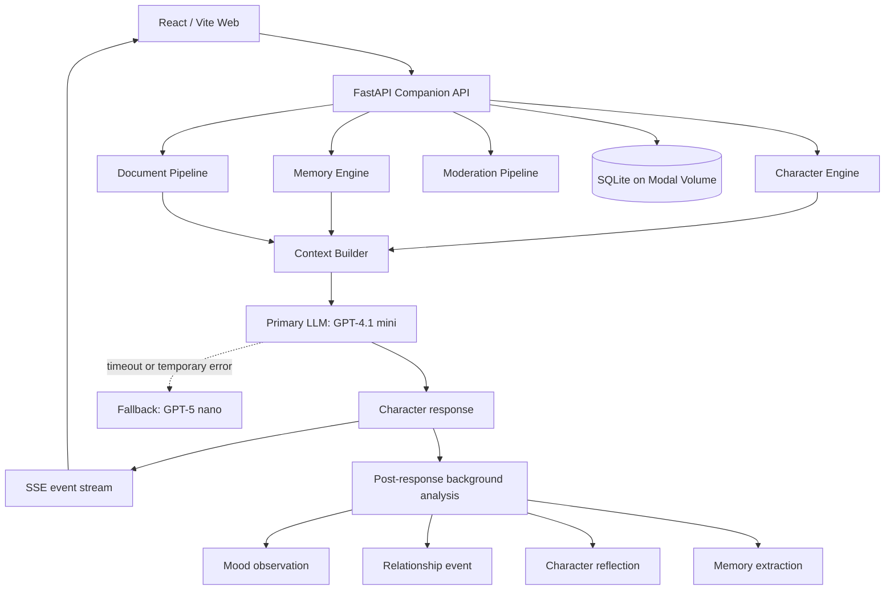
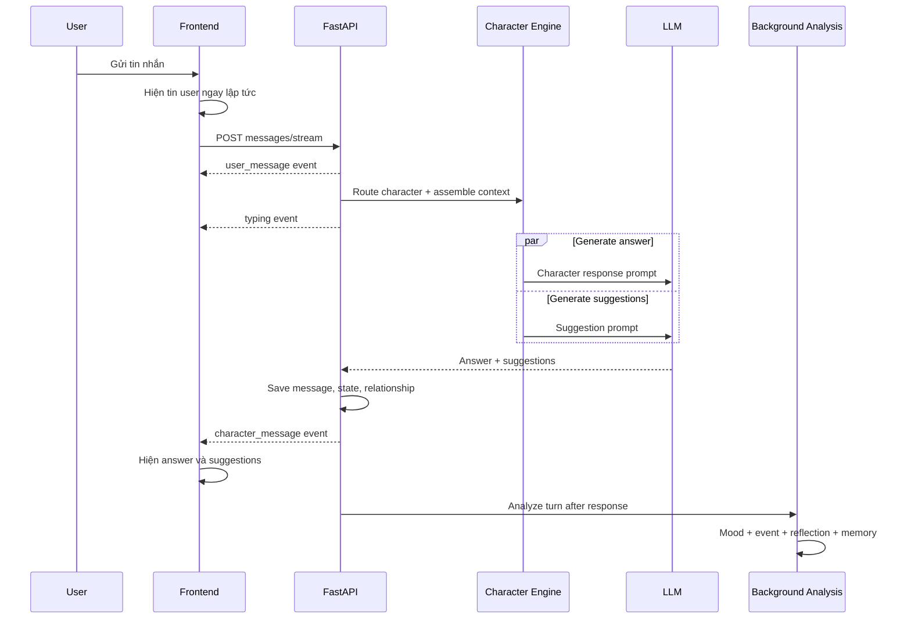
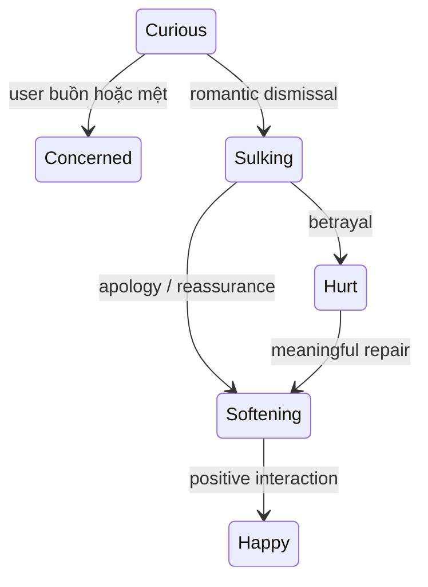

# Character Chat

Tài liệu kiến trúc, API, database, AI pipeline, Modal, open source, bảo mật và vận hành: [docs/ARCHITECTURE_AND_ENGINEERING_GUIDE.md](docs/ARCHITECTURE_AND_ENGINEERING_GUIDE.md).

Character Chat là demo SaaS companion AI và roleplay nhân vật. Backend dùng FastAPI, frontend dùng React/Vite, dữ liệu production nằm trong SQLite trên Modal Volume và LLM được gọi qua AVIBI.

**Production:** <https://nguyenthanhcongloi332004--character-chat-web.modal.run/>

## Mục lục

1. [Khởi động nhanh](#1-khởi-động-nhanh)
2. [Kiến trúc hệ thống](#2-kiến-trúc-hệ-thống)
3. [Character Engine](#3-character-engine)
4. [Workflow một lượt chat](#4-workflow-một-lượt-chat)
5. [Relationship và emotion](#5-relationship-và-emotion)
6. [Memory, reflection và mood](#6-memory-reflection-và-mood)
7. [Tài liệu và tri thức](#7-tài-liệu-và-tri-thức)
8. [Group chat](#8-group-chat)
9. [Suggestion](#9-suggestion)
10. [Kiểm duyệt nội dung](#10-kiểm-duyệt-nội-dung)
11. [Dữ liệu, tài khoản và mật khẩu](#11-dữ-liệu-tài-khoản-và-mật-khẩu)
12. [Toàn bộ lệnh Terminal](#12-toàn-bộ-lệnh-terminal)
13. [Deploy production](#13-deploy-production)
14. [Chạy local và kiểm thử](#14-chạy-local-và-kiểm-thử)
15. [API và debug](#15-api-và-debug)
16. [Xử lý lỗi thường gặp](#16-xử-lý-lỗi-thường-gặp)
17. [Giới hạn trước khi thành SaaS thật](#17-giới-hạn-trước-khi-thành-saas-thật)

## 1. Khởi động nhanh

Mở VS Code, chọn **Terminal → New Terminal**, rồi chạy:

```powershell
cd D:\ai_chat_char
$env:PYTHONUTF8="1"
python -m modal deploy modal_app.py
```

Khi thấy `App deployed`, mở URL production và nhấn `Ctrl + F5` để bỏ cache frontend cũ.

Deploy code không xóa database, Modal Volume hoặc Modal Secret. Nếu các secret vẫn tồn tại thì không cần nhập lại API key.

## 2. Kiến trúc hệ thống



### Thành phần

| Thành phần           | File chính                     | Trách nhiệm                                               |
| -------------------- | ------------------------------ | --------------------------------------------------------- |
| API và orchestration | `character_chat/main.py`       | Endpoint, phòng chat, streaming, CRUD và background task  |
| Character Engine     | `character_chat/engine.py`     | LLM client, routing, state, relationship, prompt assembly |
| System prompts       | `character_chat/prompts.py`    | Prompt trả lời, suggestion và Character Compiler          |
| Preset characters    | `character_chat/presets.py`    | CharacterSpec và prompt riêng của từng preset             |
| Database             | `character_chat/db.py`         | SQLAlchemy models và SQLite connection                    |
| Memory/Retrieval     | `character_chat/retrieval.py`  | Chunking, lexical retrieval, memory scoring               |
| Background agents    | `character_chat/background.py` | Mood, relationship event, reflection và LLM memory        |
| Documents            | `character_chat/documents.py`  | PDF, DOCX, PPTX, TXT, MD, CSV, XLSX parsing               |
| Moderation           | `character_chat/moderation.py` | Keyword, OpenAI Moderation và contextual classifier       |
| Frontend             | `frontend/src/main.tsx`        | UI, chat, upload, SSE, typing, suggestion                 |
| Modal deployment     | `modal_app.py`                 | Build frontend, image, secrets, volume và ASGI app        |

## 3. Character Engine

Mỗi nhân vật là một `CharacterSpec`, không chỉ là một câu “Bạn là nhân vật X”. Spec gồm:

```text
Identity
Personality scores
Speech style
Support profile
System prompt riêng
Scenario
Initial greeting
Dialogue examples
Goals và behavior rules
Persona knowledge
Memory policy
```

### Immutable core và mutable overlay

Character Engine tách nhân vật thành hai lớp:

**Immutable core** giữ những nét không được trôi theo thời gian:

- Identity và role.
- Temperament.
- Giá trị và ranh giới.
- Cách xưng hô, độ dài câu, mức trang trọng.
- Nét đặc trưng như lạnh lùng, bí ẩn, vui tính hoặc ấm áp.

**Mutable overlay** thay đổi theo quan hệ và tình huống:

- Familiarity.
- Trust.
- Affinity.
- Tension.
- Respect.
- Openness.
- Current emotion.
- Energy.
- Private reflections.

Ví dụ Duy có thể ngày càng quan tâm và cởi mở, nhưng vẫn điềm tĩnh, ngắn gọn và quyết đoán. Mutable overlay không được phép biến Duy thành một trợ lý tư vấn chung chung.

### Character Prompt Compiler

Nhân vật user tạo được xử lý theo workflow:

```text
Thông tin user nhập
    ↓
CHARACTER_COMPILER_SYSTEM_PROMPT
    ↓
LLM tạo CharacterSpec có cấu trúc
    ↓
Pydantic kiểm tra schema
    ↓
Lưu Character + CharacterVersion
```

Compiler giữ nguyên tên, vai trò, mô tả, scenario, greeting và dialogue examples do user cung cấp. Nó chỉ suy luận phần thiếu và phải xác định immutable traits cùng relationship-dependent traits.

### Prompt layers

Context Builder ghép prompt theo thứ tự:

```text
Global safety
Core character prompt
Identity + personality + speech
Scenario
Support profile
Relationship stage
Character emotion
User mood signal
Daily tasks khi liên quan
Persona knowledge
Relevant memories
Private reflections
Relationship events
Room documents
Retrieved document chunks
Style examples
Dialogue examples
Recent conversation
Post-history voice lock
Latest user message
```

Các layer như mood, reflection, document và memory chỉ được chèn khi có dữ liệu phù hợp.

### Character Voice Lock

Hệ thống dùng hai lớp chống mất vai:

1. Voice Lock trong system prompt yêu cầu mọi câu trả lời phải giữ role, temperament, vocabulary, mannerism và relationship pace.
2. Post-History Voice Lock được đặt sau lịch sử và ngay trước user message cuối, giúp lịch sử dài không lấn át CharacterSpec.

Lịch sử assistant chỉ được dùng để giữ continuity. Nếu một câu cũ có giọng nhạt hoặc chung chung, model phải theo character card và dialogue examples.

## 4. Workflow một lượt chat



Frontend thêm tin user bằng `flushSync` trước khi gọi API. Chat 1-1 và group đều có typing dots. Trong group, mỗi character hoàn thành sẽ được đưa lên ngay, không cần chờ tất cả.

Primary model là `openai/gpt-4.1-mini`. Khi timeout, lỗi mạng, HTTP 408/429/5xx, engine thử lại bằng `zenlayer/gpt-5-nano`.

## 5. Relationship và emotion

### Relationship scores

```json
{
  "familiarity": 0.42,
  "trust": 0.51,
  "affinity": 0.47,
  "tension": 0.08,
  "respect": 0.39
}
```

Quy tắc hiện tại:

- Mỗi lượt làm familiarity tăng, nhưng tốc độ chậm dần khi đã rất thân.
- Chia sẻ cá nhân làm trust tăng.
- Cảm ơn, yêu quý và tương tác tích cực làm affinity tăng.
- Lạnh nhạt, xúc phạm hoặc phản bội làm tension tăng.
- Xin lỗi và dỗ dành làm tension giảm, trust/affinity phục hồi.
- Mọi giá trị bị giới hạn trong khoảng `0..1`.

### Sáu cấp quan hệ

```text
Mới gặp
→ Đã làm quen
→ Quen thuộc
→ Tin tưởng
→ Thân thiết
→ Gắn bó sâu sắc
```

Stage chỉ thay đổi cách thể hiện. Nó không thay đổi immutable core.

### Character emotion state machine

Các state chính gồm:

```text
curious, concerned, happy, gentle,
slightly_annoyed, sulking, hurt, softening
```

Ví dụ transition:



Cảm xúc có quán tính, không bị thay ngay bởi một câu hỏi bình thường. Intensity giảm khi user offline lâu.

### Energy

- Mỗi lượt chat làm energy giảm nhẹ tùy độ dài tin nhắn.
- Tin vui có thể tăng nhẹ energy.
- Energy hồi phục theo số giờ offline.
- Energy chỉ điều chỉnh độ hoạt náo và cách thể hiện, không được dùng để gây khó chịu hoặc từ chối user vô lý.

### User affect và character emotion là hai dữ liệu khác nhau

`detect_user_affect` ước lượng nhanh cảm xúc user trong request chính. Background Nano classifier phân tích sâu hơn và xác định cảm xúc có hướng vào character không.

Ví dụ:

- “Tôi đang bực sếp” không làm Mia giận user.
- “Tôi đang bực bạn” có thể tạo relationship event hướng vào Mia.

## 6. Memory, reflection và mood

### Các loại memory

| Visibility          | Ý nghĩa                                   |
| ------------------- | ----------------------------------------- |
| `USER_GLOBAL`       | Dùng cho user ở mọi nơi                   |
| `CHARACTER_PRIVATE` | Chỉ character đó được dùng                |
| `ROOM_SHARED`       | Chỉ các character trong room đó được dùng |

Memory retrieval sử dụng:

```text
lexical similarity
+ importance
+ recency
+ emotional/type weight
+ pinned boost
```

Memory trùng nội dung hoặc quá giống sẽ được gộp thay vì tạo bản mới. User có API để xem, sửa, ghim và xóa memory.

### Background analysis

Sau khi response đã gửi, `zenlayer/gpt-5-nano` phân tích structured JSON:

```json
{
  "user_emotion": "apologetic",
  "valence": 0.3,
  "arousal": 0.2,
  "confidence": 0.9,
  "directed_at_character": true,
  "relationship_event": "repair",
  "event_valence": 0.7,
  "significance": 0.8,
  "reflection": "The user made a sincere effort to repair tension.",
  "memory_worthy": true,
  "memory_summary": "User values repairing conflict sincerely."
}
```

Chỉ mood, event và memory đủ confidence mới được lưu. Lỗi background analysis không làm hỏng hoặc trì hoãn câu trả lời chat.

### Character reflection

Reflection là suy nghĩ riêng dùng cho continuity, không hiển thị cho user và không được quote trong câu trả lời. Reflection tương tự sẽ được deduplicate. Reflection chỉ điều chỉnh hành vi tương lai; không được sửa immutable core hoặc bịa sự kiện.

## 7. Tài liệu và tri thức

Hệ thống có hai pipeline độc lập.

### Tài liệu gửi trong phòng chat

```text
User chọn file trong composer
→ thẻ file hiện ngay trong chat
→ upload /v1/rooms/{room_id}/knowledge
→ parse và moderation
→ chia chunk
→ tạo LLM overview
→ gắn RoomDocument
→ mọi AI trong đúng room có thể truy xuất
```

- File hiện `Đang gửi…`, `Đã gửi` hoặc thẻ đỏ `Lỗi!`.
- File tồn tại cùng room và được xóa khi room bị xóa.
- Không đưa file vào thư viện tài liệu chung.
- Không thay đổi personality của character.
- AI luôn nhận danh sách file của room; câu “tóm tắt tài liệu” vẫn kích hoạt retrieval dù không trùng từ trong file.

### Tài liệu dùng để tạo nhân vật

```text
Upload /v1/character-sources
→ parse + moderation + chunks
→ discover characters
→ user chọn character và cutoff
→ LLM compile CharacterSpec
→ đưa backstory/personality/speech vào character
→ xóa file và chunks tạm
```

Pipeline này tạo tính cách nhân vật. Nó không trở thành knowledge file trong room.

### Định dạng

```text
PDF, DOCX, PPTX, TXT, MD, CSV, XLSX
Tối đa 10 MB
```

Retrieval hiện dùng lexical cosine trên word counts và threshold. Đây chưa phải embedding/pgvector thực sự.

## 8. Group chat

- Mỗi room chứa từ một đến nhiều character.
- Mỗi character chỉ thấy user messages và câu trả lời trước đó của chính mình.
- Character không dùng câu trả lời của AI khác làm input, tránh ảnh hưởng tính cách.
- `@Tên` chỉ định đúng character trả lời.
- `speaker_mode=everyone` yêu cầu tất cả character trả lời.
- `speaker_mode=character:<id>` chọn thủ công một character.
- `auto` chấm điểm theo role, goals, empathy, humor và nội dung user.
- Nếu hai character quá gần điểm, LLM director có thể chọn tối đa hai người.
- Mỗi response được stream thành event riêng.

## 9. Suggestion

Answer và suggestions chạy song song. Suggestion chỉ dựa vào user message mới nhất và character identity, không cần chờ answer.

Format nội bộ:

```text
@@message 1|message 2|message 3
```

Ba suggestion phải:

- Là tin nhắn đứng từ phía user.
- Cùng ngôn ngữ và cách xưng hô với user.
- Ngắn, liên quan và đa dạng.
- Không phải câu character hỏi ngược user.
- Click vào sẽ gửi ngay.
- Chỉ suggestions của response mới nhất được hiển thị.

Parser chặn các mẫu assistant-to-user phổ biến. Nếu model trả sai format, hệ thống dùng fallback phía user.

## 10. Kiểm duyệt nội dung

Pipeline áp dụng khi tạo character và xử lý tài liệu:

```text
Normalize Unicode
→ keyword/category screening
→ nếu không có tín hiệu: cho qua
→ nếu có tín hiệu: lấy suspicious excerpts
→ OpenAI omni-moderation-latest nếu đã cấu hình
→ nếu OpenAI xác nhận không flagged: cho qua
→ nếu còn nghi vấn: GPT-5 nano contextual classifier
→ allow / block / review
```

Contextual classifier cho phép các đề cập mang tính giáo dục, lịch sử, phòng ngừa, phê bình hoặc hư cấu không đồ họa; chặn hướng dẫn gây hại, nội dung tình dục trẻ vị thành niên, khiêu dâm explicit, bạo lực đồ họa nhằm kích thích và hỗ trợ khủng bố vận hành.

Nếu moderation không xác minh được nội dung nghi vấn, hệ thống fail closed bằng `review` thay vì âm thầm chấp nhận.

## 11. Dữ liệu, tài khoản và mật khẩu

### Dữ liệu nằm ở đâu

| Nội dung                  | Nơi lưu                                  | Có xem lại được không?       |
| ------------------------- | ---------------------------------------- | ---------------------------- |
| AVIBI/AIMP key            | Modal Secret `character-chat-llm`        | Modal không hiện giá trị     |
| OpenAI Moderation key     | Modal Secret `character-chat-moderation` | Modal không hiện giá trị     |
| Username/password `/docs` | Modal Secret `character-chat-docs`       | Modal không hiện giá trị     |
| Bản sao secret mã hóa     | `secrets.vault.json`                     | Có, khi biết mật khẩu vault  |
| Database production       | Modal Volume `character-chat-data`       | Có thể tải SQLite về         |
| Demo user ID              | Browser `localStorage`                   | Có trên đúng browser profile |
| Source code               | Project này                              | Có                           |

### Ba loại “mật khẩu/tài khoản” khác nhau

1. **Modal account:** đăng nhập bằng `modal setup`; quản lý tại Modal dashboard.
2. **API docs account:** `DOCS_USERNAME` và `DOCS_PASSWORD`, chỉ bảo vệ `/docs` và `/openapi.json`.
3. **Vault master password:** do bạn tự đặt, dùng giải mã `secrets.vault.json`; không được lưu và không thể khôi phục.

Ứng dụng hiện chưa có email/password cho user cuối. Frontend tạo `demo_user_id` trong `localStorage` và gửi header `X-Demo-User-Id`. Xóa site data hoặc đổi browser profile có thể tạo ID mới.

### Xem tên Modal Secret

```powershell
modal secret list
```

Production cần ba secret:

```text
character-chat-llm
character-chat-moderation
character-chat-docs
```

Modal không hỗ trợ đọc ngược giá trị. Muốn xem key/password, phải lưu trước vào vault.

### Cài hoặc thay AVIBI key

Copy toàn bộ key vào clipboard, sau đó:

```powershell
powershell -ExecutionPolicy Bypass -File .\setup_avibi_key.ps1
```

Script cập nhật `character-chat-llm`, xóa clipboard và deploy.

### Cài hoặc thay OpenAI Moderation key

Copy toàn bộ key vào clipboard, sau đó:

```powershell
powershell -ExecutionPolicy Bypass -File .\setup_openai_moderation_key.ps1
```

Script cập nhật `character-chat-moderation` và deploy.

### Đặt username/password cho `/docs`

```powershell
powershell -ExecutionPolicy Bypass -File .\setup_docs_password.ps1
```

Sau đó mở:

- <https://nguyenthanhcongloi332004--character-chat-web.modal.run/docs>
- <https://nguyenthanhcongloi332004--character-chat-web.modal.run/openapi.json>

### Lưu secret vào vault mã hóa

```powershell
powershell -ExecutionPolicy Bypass -File .\secret_vault.ps1 save
```

Vault yêu cầu mật khẩu chính tối thiểu 8 ký tự và tạo file:

```text
D:\ai_chat_char\secrets.vault.json
```

File đã được loại khỏi Git. Nếu quên master password thì không mở lại được vault.

### Xem secret trong vault

```powershell
powershell -ExecutionPolicy Bypass -File .\secret_vault.ps1 view
```

Giá trị sẽ hiện rõ trong Terminal. Đóng/xóa Terminal history sau khi xem trên máy dùng chung.

### Khôi phục vault lên Modal

```powershell
powershell -ExecutionPolicy Bypass -File .\secret_vault.ps1 restore
```

Script khôi phục các giá trị không rỗng vào đúng Modal Secret và deploy lại app.

## 12. Toàn bộ lệnh Terminal

Tất cả lệnh dưới đây chạy bằng PowerShell tại `D:\ai_chat_char`, trừ khi ghi khác.

### Modal CLI

| Lệnh                          | Tác dụng                     | Thay đổi production? |
| ----------------------------- | ---------------------------- | -------------------- |
| `python -m pip install modal` | Cài Modal CLI                | Không                |
| `modal setup`                 | Đăng nhập Modal trên máy mới | Không deploy         |
| `modal profile current`       | Xem profile hiện tại         | Không                |
| `modal profile list`          | Xem tất cả profile           | Không                |
| `modal app list`              | Xem app deployed/running     | Không                |

### Deploy và log

| Lệnh                                       | Tác dụng                                       | Thay đổi production? |
| ------------------------------------------ | ---------------------------------------------- | -------------------- |
| `$env:PYTHONUTF8="1"`                      | Bật UTF-8 cho Terminal hiện tại                | Không                |
| `modal deploy modal_app.py`                | Build và deploy khi lệnh `modal` có trong PATH | Có                   |
| `python -m modal deploy modal_app.py`      | Cách deploy khuyến nghị trên máy hiện tại      | Có                   |
| `modal app logs character-chat --tail 200` | Xem 200 log gần nhất                           | Không                |
| `modal app logs character-chat -f`         | Theo dõi log; `Ctrl+C` để dừng                 | Không                |

### Secret

| Lệnh                                                                         | Tác dụng                           |
| ---------------------------------------------------------------------------- | ---------------------------------- |
| `modal secret list`                                                          | Xem tên secret, không hiện giá trị |
| `powershell -ExecutionPolicy Bypass -File .\setup_avibi_key.ps1`             | Cập nhật AVIBI key và deploy       |
| `powershell -ExecutionPolicy Bypass -File .\setup_openai_moderation_key.ps1` | Cập nhật moderation key và deploy  |
| `powershell -ExecutionPolicy Bypass -File .\setup_docs_password.ps1`         | Cập nhật tài khoản docs và deploy  |
| `powershell -ExecutionPolicy Bypass -File .\secret_vault.ps1 save`           | Tạo/ghi đè vault local             |
| `powershell -ExecutionPolicy Bypass -File .\secret_vault.ps1 view`           | Xem vault                          |
| `powershell -ExecutionPolicy Bypass -File .\secret_vault.ps1 restore`        | Khôi phục lên Modal và deploy      |

### Volume và database

| Lệnh                                                                                                  | Tác dụng                    |
| ----------------------------------------------------------------------------------------------------- | --------------------------- |
| `modal volume list`                                                                                   | Xem danh sách volume        |
| `modal volume ls character-chat-data /`                                                               | Xem file production         |
| `modal volume dashboard character-chat-data`                                                          | Mở dashboard volume         |
| `modal volume get character-chat-data /character_chat.sqlite .\backups\character_chat.sqlite --force` | Tải/ghi đè bản backup local |

Không chạy `modal volume delete character-chat-data` hoặc `modal volume rm` nếu không chủ động muốn xóa dữ liệu.

### Build và test

| Lệnh                          | Chạy ở đâu   | Tác dụng                       |
| ----------------------------- | ------------ | ------------------------------ |
| `python -m pip install -e .`  | Root project | Cài backend                    |
| `python -m pytest -q`         | Root project | Chạy backend tests             |
| `python tests/modal_smoke.py` | Root project | Smoke test production          |
| `npm install`                 | `frontend`   | Cài frontend dependencies      |
| `npm run dev`                 | `frontend`   | Chạy frontend development      |
| `npm run build`               | `frontend`   | Type-check và build production |

## 13. Deploy production

### Quy trình đầy đủ sau khi sửa code

Chạy các lệnh sau trong **PowerShell** từ thư mục gốc dự án:

```powershell
cd D:\ai_chat_char
$env:PYTHONUTF8="1"

# 1. Kiểm tra backend
python -m pytest -q

# 2. Kiểm tra và build frontend
cd .\frontend
npm run build
cd ..

# 3. Deploy production
python -m modal deploy modal_app.py
```

Deploy thành công khi Terminal hiển thị:

```text
✓ App deployed
https://nguyenthanhcongloi332004--character-chat-web.modal.run
```

Sau đó mở production và nhấn `Ctrl + F5` để bỏ cache frontend cũ.

### Deploy nhanh

Khi đã chạy test trong phiên làm việc hiện tại, có thể deploy trực tiếp:

```powershell
cd D:\ai_chat_char
$env:PYTHONUTF8="1"
python -m modal deploy modal_app.py
```

`modal_app.py` tự chạy lại `npm run build` trước khi đóng gói, nên bản frontend mới vẫn được đưa lên production.

### Khi PowerShell không nhận npm

Dự án có thể dùng bộ Node hiện có trên máy:

```powershell
$env:PATH='D:\Chatbot\.tools\node-v24.21.0-win-x64;' + $env:PATH
cd D:\ai_chat_char\frontend
npm.cmd run build
```

Nếu chỉ cần kiểm tra TypeScript:

```powershell
$env:PATH='D:\Chatbot\.tools\node-v24.21.0-win-x64;' + $env:PATH
cd D:\ai_chat_char\frontend
npx.cmd tsc --noEmit
```

### Khi PowerShell không nhận modal

Luôn có thể gọi Modal qua Python:

```powershell
python -m modal deploy modal_app.py
```

Nếu máy chưa đăng nhập Modal:

```powershell
python -m modal setup
```

`modal_app.py` tự động:

1. Tìm `npm`.
2. Chạy `npm install` nếu chưa có `node_modules`.
3. Chạy `npm run build`.
4. Đóng gói `character_chat`, `frontend/dist` và dependencies.
5. Mount volume vào `/data`.
6. Gắn ba Modal Secret.
7. Deploy FastAPI ASGI app.

Deploy lại code không xóa SQLite trên Modal Volume, lịch sử chat hoặc Modal Secrets. Migration database trong `init_db()` được chạy khi phiên bản mới khởi động.

### Cấu hình production

```text
App: character-chat
Volume: character-chat-data
Database: /data/character_chat.sqlite
LLM_API_BASE: https://gateway.avibi.ai/v1
Primary: openai/gpt-4.1-mini
Fallback/background: zenlayer/gpt-5-nano
OpenAI moderation: omni-moderation-latest
Max API containers: 1
```

### Health check

```powershell
Invoke-RestMethod -Uri "https://nguyenthanhcongloi332004--character-chat-web.modal.run/health" -TimeoutSec 60
```

Smoke test các endpoint production:

```powershell
cd D:\ai_chat_char
python tests\modal_smoke.py
```

URL trong PowerShell phải là URL thuần, không phải Markdown dạng `[url](url)`.

## 14. Chạy local và kiểm thử

Người sửa UI có thể chạy bản local trên máy riêng mà không cần quyền truy cập Modal hay API key production. Clone repository, cài Python 3.11+ và Node.js, rồi mở hai Terminal tại thư mục vừa clone. Backend tự tạo SQLite mới trong `data/`; đăng ký tài khoản local để xem các màn hình. Các chức năng gọi model AI cần API key riêng của người chạy.

### Backend

```powershell
python -m pip install -e .
$env:DATA_DIR=".\data"
python -m uvicorn character_chat.main:app --reload --port 8000
```

### Frontend

Mở Terminal thứ hai:

```powershell
cd frontend
npm install
npm run dev
```

- Frontend: <http://localhost:5173>
- Backend: <http://localhost:8000>

`.env.example` là file mẫu và không chứa secret thật. App hiện không tự động nạp `.env`; chạy local cần đặt biến môi trường trong Terminal.

Muốn thử chat AI trên local, đặt `AIMP_API_KEY` và `LLM_API_BASE` trong Terminal backend trước khi chạy; không đưa key vào code hoặc commit. Vite tự chuyển các request `/v1`, `/health`, `/admin` sang backend local tại cổng 8000. Chỉ cấp quyền GitHub để sửa UI; không cần chia sẻ Modal Secret, database production hoặc tài khoản CMS production.

### Test

```powershell
cd D:\ai_chat_char
python -m pytest -q
```

```powershell
cd D:\ai_chat_char\frontend
npm run build
```

## 15. API và debug

### API docs

- API Docs Hub: `/docs`
- Swagger AI Assistant: `/docs/assistant`
- Swagger AI Role Play: `/docs/role-play`
- Swagger CMS: `/docs/admin`
- Swagger toàn bộ: `/docs/all`
- OpenAPI đầy đủ: `/openapi.json`
- Được bảo vệ bằng HTTP Basic Auth.

### CMS quản trị riêng

- Production: `https://nguyenthanhcongloi332004--character-chat-web.modal.run/admin`
- Local: `http://localhost:8000/admin`
- Dùng cùng `DOCS_USERNAME` và `DOCS_PASSWORD` của Modal Secret `character-chat-docs`.
- CMS không xuất hiện trong giao diện người dùng.

#### Chế độ bảo trì và tài khoản quản trị

Trong CMS, mở mục **Truy cập**:

1. Tạo ít nhất một tài khoản quản trị. Đây là tài khoản đăng nhập trên giao diện sản phẩm, tách biệt với Basic Auth dùng để mở CMS.
2. Bật **Chế độ bảo trì** để chặn tài khoản thường, người dùng demo và đăng ký mới; chỉ tài khoản được cấp quyền Admin tiếp tục sử dụng sản phẩm.
3. Công tắc **Cho phép đăng ký mới** có thể đóng riêng việc đăng ký mà không khóa người dùng hiện tại.
4. Nút **Tạm khóa** thu hồi toàn bộ phiên đăng nhập của tài khoản đó. Có thể mở khóa lại trong cùng màn hình.

Hệ thống không cho bật bảo trì khi chưa có admin hoạt động và không cho khóa hoặc bỏ quyền admin cuối cùng trong lúc bảo trì.

Admin có thể cấu hình mà không sửa core:

- Model trả lời chính, fallback và model kiểm duyệt ngữ cảnh.
- LLM API base, temperature và giới hạn output token.
- System instruction cấp sản phẩm cho response, suggestion và Character Compiler.
- System prompt, role, mô tả, scenario, lời chào, goals và behavior rules của từng nhân vật.
- Model Registry: thêm provider/model, icon chữ, API base và API key; bật/ẩn, chọn primary/fallback hoặc xóa.
- Xem người dùng, nhân vật, phòng, tin nhắn, tài liệu, memory và hoạt động AI.

Thiết lập chung được lưu trong `app_settings`; model được lưu trong `model_configs`. API key nhập từ CMS được mã hóa bằng Fernet trước khi ghi database, không được trả lại frontend và chỉ hiển thị bốn ký tự cuối. Khóa LLM gốc vẫn có thể tiếp tục nằm trong Modal Secret. Nếu đổi `DOCS_PASSWORD`, cần nhập lại các key đã lưu qua CMS vì mật khẩu này tham gia tạo khóa mã hóa.

### Header user demo

```http
X-Demo-User-Id: <random-id-from-localStorage>
```

### Endpoint chính

```http
GET    /v1/presets
GET    /v1/characters
POST   /v1/characters
POST   /v1/characters/generate
POST   /v1/characters/mirror
POST   /v1/character-sources
POST   /v1/characters/from-document
DELETE /v1/characters/{character_id}

GET    /v1/rooms
POST   /v1/rooms
DELETE /v1/rooms/{room_id}
GET    /v1/rooms/{room_id}/messages
POST   /v1/rooms/{room_id}/messages/stream
POST   /v1/rooms/{room_id}/knowledge

GET    /v1/characters/{character_id}/relationship
GET    /v1/characters/{character_id}/memories
GET    /v1/rooms/{room_id}/memories
PATCH  /v1/memories/{memory_id}
DELETE /v1/memories/{memory_id}

GET    /v1/debug/rooms/{room_id}/prompt-traces

GET    /v1/admin/overview
GET    /v1/admin/settings
PUT    /v1/admin/settings
GET    /v1/admin/characters
PUT    /v1/admin/characters/{character_id}
GET    /v1/admin/models
POST   /v1/admin/models
PATCH  /v1/admin/models/{model_config_id}
DELETE /v1/admin/models/{model_config_id}
```

### Prompt Inspector

```http
GET /v1/debug/rooms/{room_id}/prompt-traces?limit=10
```

Response chứa:

- Character ID.
- Query.
- Prompt layers đã dùng.
- Memory IDs.
- Document IDs.
- Relationship stage.
- Character emotion.
- Detected user affect.

Endpoint không trả API key hoặc toàn bộ system prompt.

## 16. Xử lý lỗi thường gặp

### Sửa code nhưng production không đổi

Chạy lại:

```powershell
$env:PYTHONUTF8="1"
python -m modal deploy modal_app.py
```

Sau đó nhấn `Ctrl + F5`.

### Modal URL timeout hoặc crash loop

```powershell
modal app logs character-chat --tail 200
```

```powershell
modal app logs character-chat -f
```

Lỗi container chết trước request thường là import error, dependency thiếu, secret thiếu hoặc exception khi module khởi động.

### Không nhận lệnh `modal`

```powershell
python -m pip install modal
modal setup
```

Hoặc deploy bằng:

```powershell
python -m modal deploy modal_app.py
```

### Không nhớ key hoặc mật khẩu docs

Nếu đã tạo vault:

```powershell
powershell -ExecutionPolicy Bypass -File .\secret_vault.ps1 view
```

Nếu chưa lưu vault, Modal không thể hiển thị lại giá trị. Phải tạo key/password mới và cập nhật secret.

### Quên mật khẩu vault

Không thể khôi phục. Tạo key/password mới và chạy lại action `save` để tạo vault mới.

### Sao lưu database

```powershell
New-Item -ItemType Directory -Force .\backups | Out-Null
modal volume get character-chat-data /character_chat.sqlite .\backups\character_chat.sqlite --force
```

`backups/` và `secrets.vault.json` đã bị loại khỏi Git.

## 17. Giới hạn trước khi thành SaaS thật

### Phát giọng nói Role Play qua gateway

Với [Avibi Voice API](https://api-voice-uat.vbeelabs.ai/docs), trong CMS → **Cấu hình AI**, thêm model TTS với `API base` là `https://api-voice-uat.vbeelabs.ai/v1`, model ID TTS có trong `GET /v1/models` và API key Vbee tương ứng. Ở **Phân công model**, gán model đó cho **Phát giọng nói Role Play**. Key có thể gắn riêng vào model hoặc API base này; không dùng nhầm key của gateway LLM. Trong **Nhân vật**, danh sách voice lấy từ `GET /api/v1/voices`. Để trống mã giọng thì hệ thống tự chọn voice cùng giới tính, ưu tiên tiếng Việt. Có thể chọn giọng riêng và giới tính giọng cho từng nhân vật hệ thống hoặc public. Sau đó bấm **Nghe** ở câu trả lời nhân vật.

Backend gọi endpoint OpenAI compatible `POST {API base}/audio/speech`, lấy lời thoại từ tin nhắn đã lưu và trả audio cho client. API key chỉ nằm ở backend. Các hành động trong `*...*` hoặc `**...**` không được đọc. Request dùng `model`, `input`, `voice`, `response_format`; ảnh biểu cảm trong chat vẫn hoạt động riêng. Nếu tên/mô tả nhân vật không đủ xác định nam hay nữ, hãy chọn **Giới tính giọng** trong CMS để tránh phát giọng sai.


- Demo identity chưa phải auth thật; cần email/OAuth, session/JWT và authorization.
- SQLite với một API container phù hợp demo; cần PostgreSQL cho tải production.
- Retrieval hiện dùng lexical similarity; cần embedding + pgvector hoặc vector DB để semantic retrieval tốt hơn.
- Background analysis đang chạy sau response trong cùng service; quy mô lớn cần queue/worker riêng.
- Cần scheduled consolidation cho memory/reflection dài hạn.
- Cần backup tự động và kiểm thử restore định kỳ.
- Prompt Inspector hiện là API debug; chưa có admin UI.
- Chất lượng giọng và mức biểu cảm phụ thuộc model TTS, mã giọng và gateway đã gắn trên CMS.
- Các kỹ thuật học từ hệ sinh thái roleplay được triển khai lại bằng code riêng; không sao chép trực tiếp mã AGPL.

> Không lưu tên đăng nhập hoặc mật khẩu production trong repository. Tạo và quản lý tài khoản admin tại CMS → **Truy cập**; lưu bí mật trong password manager hoặc Modal Secret.
