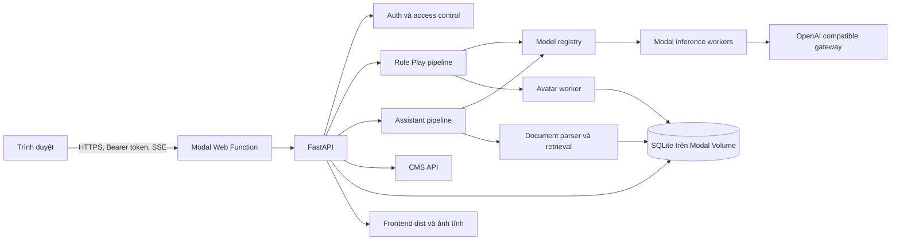
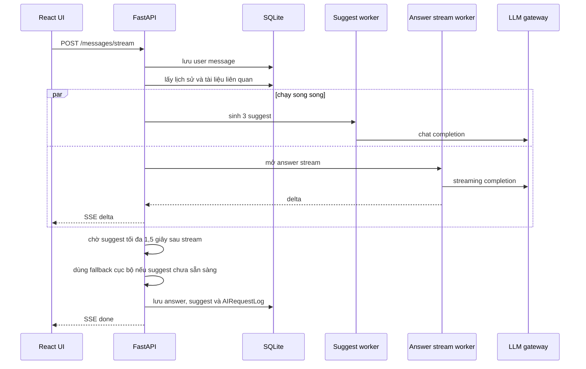

# Avibi Platform — kiến trúc và cẩm nang kỹ thuật

> Tài liệu này mô tả trạng thái code hiện tại. Mục tiêu là giúp một kỹ sư mới có thể hiểu sản phẩm, chạy local, theo dõi một request từ trình duyệt tới model, vận hành Modal, đọc dữ liệu và tiếp tục tách kiến trúc mà không làm vỡ frontend.

## 1. Sản phẩm là gì

Avibi Platform dùng chung một tài khoản cho hai không gian:

1. **AI Role Play**: tạo nhân vật, phòng đơn hoặc nhóm, ký ức, quan hệ, trạng thái nhân vật, biểu cảm, nhân vật public và tương tác cộng đồng.
2. **AI Assistant**: trợ lý tổng quát, tâm lý, sức khỏe, bài tập, Tarot và Tử vi; hỗ trợ upload tài liệu hoặc ảnh.
3. **CMS**: quản lý model, prompt, fallback, API key, nhân vật hệ thống, logchat, database explorer, chế độ bảo trì và tài khoản admin.

Hai sản phẩm dùng chung identity, database, model registry và hạ tầng triển khai, nhưng prompt, nhiệm vụ, lịch sử và cấu hình hiển thị model được tách theo product.

## 2. Sơ đồ tổng thể



### Một request chat Assistant



## 3. Bản đồ source code

### Backend

| File | Trách nhiệm |
|---|---|
| `character_chat/main.py` | FastAPI app, dependencies, endpoint, orchestration, CMS và static frontend. Đây là monolith cần tiếp tục tách. |
| `character_chat/db.py` | SQLAlchemy models, engine, session factory và migration SQLite nhỏ. |
| `character_chat/schemas.py` | Pydantic contracts, CharacterSpec và input models. |
| `character_chat/engine.py` | LLM client, prompt assembly, routing, parser suggest, fallback và relationship logic. |
| `character_chat/prompts.py` | Base prompt của Role Play, moderation và emotion. |
| `character_chat/assistant_prompts.py` | Base prompt riêng cho từng nhiệm vụ Assistant. |
| `character_chat/assistant_pipeline.py` | Retrieval context và guardrail theo nhiệm vụ Assistant. |
| `character_chat/retrieval.py` | Embedding đơn giản, memory retrieval và context selection. |
| `character_chat/documents.py` | Parse PDF, DOCX, PPTX, XLSX và text; chunk và lưu knowledge. |
| `character_chat/moderation.py` | Kiểm duyệt nội dung và tích hợp moderation model. |
| `character_chat/avatar_pipeline.py` | Tối ưu ảnh, ảnh biểu cảm mặc định và pipeline sinh biểu cảm. |
| `character_chat/background.py` | Phân tích lượt chat và cập nhật state/memory nền. |
| `character_chat/character_research.py` | Nhận diện và nghiên cứu nhân vật phim/hoạt hình để tái sử dụng identity. |
| `character_chat/presets.py` | Nhân vật hệ thống mặc định. |
| `character_chat/zodiac.py` | Dữ liệu phụ trợ cho archetype cung hoàng đạo. |

### Frontend

| File | Trách nhiệm |
|---|---|
| `frontend/src/main.tsx` | Gateway, đăng nhập, AI Role Play và phần lớn UI chính. |
| `frontend/src/assistant/AssistantApp.tsx` | UI riêng cho AI Assistant. |
| `frontend/src/admin.ts` | CMS frontend. |
| `frontend/src/i18n.ts` | Ngôn ngữ, error localization, runtime translation và bảo vệ nội dung chat khỏi dịch. |
| `frontend/src/style.css` | UI tổng thể và Role Play. |
| `frontend/src/chat.css` | Phòng chat Role Play. |
| `frontend/src/assistant/assistant.css` | UI Assistant. |
| `frontend/src/admin.css` | UI CMS. |

### Hạ tầng và vận hành

| File | Trách nhiệm |
|---|---|
| `modal_app.py` | Build frontend, khai báo Modal Image, Volume, Secret, worker và ASGI web app. |
| `setup_*.ps1` | Cập nhật secret và deploy theo từng loại credential. |
| `secret_vault.ps1` | Backup hoặc restore secret vận hành. |
| `tests/test_app.py` | Integration tests FastAPI và database. |
| `tests/ui_*.mjs` | Kiểm tra hành vi UI và timing. |
| `THIRD_PARTY_NOTICES.md` | Nguồn tham khảo bên thứ ba và tình trạng license. |

## 4. Công nghệ và lý do sử dụng

### Python và FastAPI

- FastAPI cung cấp ASGI, dependency injection, validation, upload file, streaming response và OpenAPI.
- `Depends(current_user)` gom xác thực vào dependency dùng lại.
- `StreamingResponse` truyền SSE để client thấy câu trả lời theo từng delta.
- `/docs` và `/openapi.json` được bảo vệ bằng HTTP Basic riêng.
- Hướng dẫn chính thức: [FastAPI](https://fastapi.tiangolo.com/), [Bigger Applications](https://fastapi.tiangolo.com/tutorial/bigger-applications/).

### Pydantic

- Dùng cho request contracts và `CharacterSpec` có cấu trúc.
- Giúp model compiler trả dữ liệu có schema thay vì JSON tự do.
- Official docs: [Pydantic](https://docs.pydantic.dev/latest/).

### SQLAlchemy và SQLite

- SQLAlchemy ORM mô hình hóa dữ liệu và quản lý transaction qua `Session`.
- SQLite phù hợp demo và một web container ghi dữ liệu.
- Modal web function đang giới hạn `max_containers=1` vì một file SQLite không phù hợp với nhiều writer phân tán.
- Official docs: [SQLAlchemy Session basics](https://docs.sqlalchemy.org/en/20/orm/session_basics.html).

### React, TypeScript và Vite

- React quản lý state và render ba trải nghiệm trong cùng frontend build.
- TypeScript kiểm tra contracts phía client.
- Vite build hashed assets vào `frontend/dist`.
- Không dùng router framework; route sản phẩm được chọn từ `window.location` và FastAPI trả cùng `index.html`.
- Official docs: [React](https://react.dev/), [TypeScript](https://www.typescriptlang.org/docs/), [Vite](https://vite.dev/guide/).

### HTTPX

- Gọi gateway theo giao thức OpenAI compatible.
- Cấu hình connect/read/write/pool timeout riêng.
- Tái sử dụng connection pool trong Modal worker để giảm TLS handshake.
- Official docs: [HTTPX](https://www.python-httpx.org/).

### Xử lý tài liệu

| Định dạng | Thư viện |
|---|---|
| PDF | PyMuPDF |
| DOCX | python-docx |
| PPTX | python-pptx |
| XLSX | openpyxl |
| Form upload | python-multipart |
| Mã hóa credential CMS | cryptography/Fernet |
| Ảnh | Pillow; worker avatar còn dùng rembg CPU |

## 5. Modal được dùng như thế nào

### Tài nguyên

- App: `character-chat`.
- Volume: `character-chat-data`, mount tại `/data`.
- Secrets:
  - `character-chat-llm`
  - `character-chat-moderation`
  - `character-chat-docs`
- Runtime image chứa backend, frontend đã build và ảnh bundled.
- Avatar image cài thêm `rembg[cpu]`.

### Function

| Function | CPU/RAM | Scale | Mục đích |
|---|---:|---|---|
| `web` | 0.5 CPU / 1 GB | 1 container, 20 concurrent inputs | FastAPI, SQLite writer và static frontend. |
| `assistant_worker` | 1 CPU / 1 GB | tối đa 10 | Completion không stream, chủ yếu suggest. |
| `assistant_stream_worker` | 1 CPU / 1 GB | tối đa 10 | Stream câu trả lời Assistant. |
| `process_avatar` | 2 CPU / 4 GB | tối đa 4 | Sinh hoặc dựng 6 biểu cảm. |
| `backfill_avatars` | 1 CPU / 2 GB | job dài | Bổ sung ảnh còn thiếu. |
| `regenerate_avatar` | 1 CPU / 2 GB | job dài | Tạo lại đúng một nhân vật. |
| `optimize_*` | 1 CPU | job thủ công | Giảm dung lượng ảnh đã lưu. |

Modal Web Functions có cold start và có thể nhận nhiều input trên một container với `@modal.concurrent`; khi đạt giới hạn container, request sẽ đợi trong queue. Xem [Modal Web Functions](https://modal.com/docs/guide/webhooks) và [Input concurrency](https://modal.com/docs/guide/concurrent-inputs).

Modal Volume cần `commit()` để đảm bảo thay đổi từ job được persist. Một file có semantics last-write-wins khi bị ghi đồng thời, là lý do SQLite web tier hiện chỉ có một container. Xem [Modal Volumes](https://modal.com/docs/guide/volumes).

Secrets được inject thành environment variables, không bundle vào frontend. Xem [Modal Secrets](https://modal.com/docs/guide/secrets).

### Build và deploy

```powershell
cd D:\ai_chat_char
python -m pytest tests/test_app.py -q
cd frontend
npm run build
cd ..
python -m modal deploy modal_app.py
```

`modal_app.py` tự build frontend trước khi tạo Modal image. Khi container import module trên cloud, nó dùng `frontend/dist` đã được đóng gói.

### Khi cần tách dev và production

Nên dùng Modal Environments riêng để secret, volume và deployment thử nghiệm không đè production. Xem [Modal Environments](https://modal.com/docs/guide/environments).

## 6. Database

### Identity

- `users`: identity gốc.
- `user_accounts`: username, password hash, theme, status và quyền admin.
- `user_sessions`: hash của bearer token và thời hạn.
- `user_profiles`: bio, language, reduced motion.
- `user_avatars`: binary avatar.

Password dùng PBKDF2-HMAC-SHA256 với salt riêng. Database không lưu token thô, chỉ SHA-256 token hash.

### Character và cộng đồng

- `characters`: owner, name và serialized CharacterSpec.
- `character_versions`: snapshot spec.
- `character_publications`: public/private, type và tags.
- `character_assets`: avatar card.
- `character_expression_assets`: 6 ảnh neutral/happy/sad/angry/surprised/shy.
- `character_ratings`, `character_reactions`, `character_usage`, `creator_follows`: social graph và ranking.
- `style_examples`: ví dụ phong cách thoại.

### Chat

- `rooms`: cả Role Play và Assistant; Assistant được phân biệt bằng prefix tên `assistant:`.
- `room_members`: nhân vật trong phòng Role Play.
- `messages`: user, character, assistant hoặc document message.
- `message_alternatives`: câu trả lời khác.
- `message_suggestions`: ba gợi ý gắn với answer.

### Knowledge

- `documents`: metadata file và ingestion status.
- `document_chunks`: text, metadata, embedding.
- `assistant_files`: binary ảnh Assistant cần gửi trực tiếp cho vision model.
- `room_documents`: knowledge scope của một room.
- `character_knowledge`: nguồn kiến thức của character.

### Memory và mô phỏng quan hệ

- `memories`: memory có type, importance, visibility và pinned.
- `relationships`: score tổng và dimensions quan hệ.
- `character_states`: mood và state theo thời gian.
- `relationship_events`, `mood_observations`, `character_reflections`: lịch sử biến đổi.
- `prompt_traces`: context layer đã đưa vào prompt.
- `daily_tasks`: tác vụ của người dùng.

### Vận hành

- `model_configs`: registry model dùng chung nhưng có field hiển thị Assistant riêng.
- `app_settings`: prompt profile, assignment, cache dịch, feature settings và credential đã mã hóa.
- `processing_jobs`: trạng thái job.
- `ai_request_logs`: input/output, model chính, hai fallback, nguyên nhân fallback, latency, thinking, finish status và lỗi.

### Migration hiện tại

`Base.metadata.create_all()` tạo bảng mới. `init_db()` dùng các `ALTER TABLE` nhỏ để thêm cột cho SQLite cũ. Cách này đủ cho demo nhưng không thay thế migration framework. Khi chuyển PostgreSQL nên dùng Alembic.

## 7. Xác thực và kiểm soát truy cập

### User auth

1. Register tạo `User`, `UserAccount` và session.
2. Login kiểm tra PBKDF2 password hash.
3. Client nhận bearer token; server chỉ lưu token hash.
4. `current_user` kiểm tra session expiry, account status và maintenance mode ở mọi endpoint được bảo vệ.

### CMS auth

- `/admin`, `/docs`, `/openapi.json` và `/v1/admin/*` dùng HTTP Basic từ `character-chat-docs`.
- Tài khoản admin sản phẩm là một lớp khác: nó đăng nhập như user và được phép hoạt động khi maintenance mode bật.
- Không lưu mật khẩu thật trong README, source, frontend hoặc git.

### Maintenance mode

- Tài khoản thường và demo bị từ chối.
- Admin sản phẩm vẫn dùng được app.
- CMS Basic Auth vẫn dùng được để mở khóa.
- Không thể bật maintenance nếu chưa có admin active.
- Không thể vô hiệu hóa admin cuối cùng trong lúc maintenance.

### Credential model

- Modal Secret là nguồn gốc an toàn.
- CMS có thể override API key; giá trị được mã hóa bằng Fernet trước khi lưu.
- API trả hint bốn ký tự cuối, không trả secret.
- Database explorer redact password hash, token hash và encrypted key.

## 8. Model registry, prompt và fallback

### Quy tắc ưu tiên

1. CMS chọn model và prompt đang hoạt động.
2. Base prompt trong code là dự phòng khi CMS chưa cấu hình.
3. Role Play và Assistant dùng purpose riêng.
4. Một core model có thể dùng ở cả hai product nhưng tên hiển thị và cấu hình Assistant có field riêng.

### Role Play purposes

- `response`
- `fallback`, `fallback_2`
- `suggestion`, `suggestion_fallback`, `suggestion_fallback_2`
- `compiler`
- `moderation`
- `emotion`, `emotion_fallback`, `emotion_fallback_2`
- `avatar_image`

### Assistant purposes

Mỗi nhiệm vụ có ba slot:

- `{purpose}`: primary
- `{purpose}_fallback`
- `{purpose}_fallback_2`

Purpose gồm `assistant_general`, `assistant_psychology`, `assistant_health`, `assistant_homework`, `assistant_tarot` và `assistant_suggestion`.

### Khi fallback xảy ra

- timeout connect/read
- SSL handshake timeout
- gateway 408/5xx
- server disconnect
- empty response
- circuit breaker đang mở sau network failure gần nhất

`AIRequestLog` ghi primary, fallback 1, fallback 2, actual model, lý do, latency và output. Circuit breaker tạm bỏ qua model vừa lỗi mạng trong 30 giây.

### Thinking

- `thinking_mode`: default, enabled hoặc disabled.
- `reasoning_effort`: default, low, high hoặc max.
- Các field chỉ được gửi khi gateway/model hỗ trợ.
- Không thể suy ra thinking chỉ từ tên model; cần xem payload và response/log của gateway.

## 9. Role Play pipeline

1. Xác thực user và ownership của room.
2. Lưu user message.
3. Route speaker theo `auto`, một nhân vật hoặc everyone.
4. Assemble context: CharacterSpec, scenario, lịch sử, memory, relationship, state, document và instruction.
5. Gọi response model; thử fallback nếu cần.
6. Detect emotion bằng model nhẹ, sau đó fallback hoặc heuristic.
7. Chọn expression asset tương ứng trước khi hoàn tất UI answer.
8. Sinh suggest; fallback cục bộ nếu model lỗi hoặc quá chậm.
9. Lưu answer, source, expression, suggest và log.
10. Background analysis cập nhật memory/relationship/state.

### Ký ức và quan hệ

Memory không phải toàn bộ lịch sử. Hệ thống rút trích thông tin có ích, gán importance và scope. Relationship/state thay đổi dần qua event thay vì thay toàn bộ personality ngay sau một câu.

### Biểu cảm

- Mỗi nguồn identity hướng tới 6 ảnh.
- Character clone hoặc cùng identity có thể dùng chung expression source.
- Nhân vật không có avatar không gọi image model.
- CMS tắt image model thì dùng icon mặc định nhưng giữ workflow.
- Emotion được tính cho mỗi lượt trả lời; frontend không giữ cứng emotion của phiên trước.

## 10. Assistant pipeline

### Nhiệm vụ

- General: trả lời tổng quát.
- Psychology: hỗ trợ wellbeing, không chẩn đoán.
- Health: thông tin sức khỏe thận trọng, cảnh báo red flags.
- Homework: hướng dẫn từng bước.
- Tarot/Tử vi: chiêm nghiệm, không khẳng định định mệnh; lựa chọn và nỗ lực của người dùng mới thay đổi cuộc sống.

### File upload

1. Client upload file vào room.
2. Backend kiểm tra type/size.
3. Text document được parse và chunk.
4. Ảnh được tối ưu và lưu `assistant_files`.
5. Khi user gửi câu hỏi kèm attachment ID, backend đưa đúng file/context vào cùng request.
6. Retrieval chỉ lấy knowledge của room hiện tại.
7. Delete chat xóa room và dependent documents nếu không còn reference.

### Retrieval

Đây là RAG tự triển khai, không dùng LangChain hoặc LlamaIndex:

- parse → chunk → embedding representation → relevance selection → prompt context.
- attached file của câu hỏi hiện tại được force include.
- source metadata được trả về UI.
- history bị giới hạn số message và tổng ký tự để giảm timeout.

### Streaming và suggest song song

- Answer chạy bằng remote generator.
- Suggest bắt đầu trước khi answer stream mở.
- Khi answer xong, API chờ suggest tối đa 1,5 giây.
- Nếu chưa xong, API dùng fallback cục bộ theo ngôn ngữ user.
- Nếu answer phải fallback lâu nhưng suggest đã xong, suggest được giữ và chỉ gửi cùng event `done`.

## 11. Đa ngôn ngữ

Ba loại nội dung phải phân biệt:

1. **UI/system text**: theo language trong profile.
2. **Initial greeting và mô tả hệ thống**: localized theo profile và có cache.
3. **Conversation**: giữ nguyên user message; model trả theo ngôn ngữ user đang chat. Frontend gắn `translate="no"` và `data-no-translate` cho message/suggest.

Runtime translation cache:

- Browser cache có version.
- Server cache dùng key hash theo language và source.
- Kết quả giống nguyên văn không được cache như một bản dịch thành công.
- Khi model dịch lỗi, request sau được phép thử lại.

## 12. API hiện tại

Base prefix là `/v1`. URL giữ ổn định để không phá client.

### Nhóm OpenAPI mới

`/docs` là trang chọn tài liệu theo miền sản phẩm. Mỗi lựa chọn mở một Swagger độc lập, nên CMS, Assistant và Role Play không còn nằm chung trong một danh sách dài:

- `/docs/assistant` dùng schema `/openapi/assistant.json`.
- `/docs/role-play` dùng schema `/openapi/role-play.json`.
- `/docs/admin` dùng schema `/openapi/admin.json`.
- `/docs/all` dùng schema đầy đủ `/openapi/all.json`.
- `/openapi.json` vẫn là schema đầy đủ để giữ tương thích với công cụ đang sử dụng URL cũ.

Trong trang toàn bộ, endpoint tiếp tục được chia thành:

- System
- Identity & localization
- AI Assistant
- Role Play
- Characters
- Documents & knowledge
- Memory & state
- CMS — access
- CMS — content
- CMS — AI configuration
- CMS — observability

### Endpoint chính

| Nhóm | Endpoint tiêu biểu |
|---|---|
| Auth | `POST /v1/auth/register`, `POST /v1/auth/login`, `GET/PATCH /v1/auth/me`, `POST /v1/auth/logout` |
| Localization | `POST /v1/i18n/translate` |
| Assistant | `/v1/assistant/models`, `/v1/assistant/chats`, `/files`, `/messages`, `/messages/stream` |
| Characters | `/v1/characters`, `/generate`, `/mirror`, `/publication`, `/avatar`, `/expression` |
| Community | `/v1/public/characters`, `/clone`, `/rating`, `/reaction`, `/follow` |
| Role Play | `/v1/rooms`, `/messages`, `/messages/stream`, `/regenerate` |
| Documents | `/v1/documents`, `/from-url`, `/discover-characters`, `/character-sources` |
| Memory | `/memories`, `/relationship`, `/daily-tasks`, `/prompt-traces` |
| CMS | `/v1/admin/*` |

### Contract streaming

Assistant và Role Play dùng `text/event-stream`:

- `delta`: một đoạn text mới.
- `typing`: nhân vật bắt đầu soạn trong Role Play.
- `user_message`: canonical message đã lưu.
- `character_message`: Role Play answer hoàn tất.
- `done`: Assistant answer, sources và suggestions hoàn tất.
- `error`: lỗi có message/detail.

## 13. Thiết kế lại API theo module

### Vấn đề hiện tại

`character_chat/main.py` chứa hơn hai nghìn dòng và nhiều domain. Hệ quả:

- import coupling cao;
- khó test một domain độc lập;
- endpoint và service logic trộn nhau;
- helper dùng state toàn cục;
- refactor dễ tạo circular import;
- nhiều response dùng `dict` thay vì schema cụ thể.

### Trạng thái đã làm

OpenAPI đã được nhóm theo domain mà không đổi URL. Đây là bước an toàn đầu tiên.

### Cấu trúc đích

```text
character_chat/
  app.py
  core/
    config.py
    security.py
    errors.py
    logging.py
  api/
    dependencies.py
    routers/
      auth.py
      localization.py
      assistant.py
      roleplay.py
      characters.py
      documents.py
      memories.py
      admin_access.py
      admin_content.py
      admin_models.py
      admin_observability.py
  services/
    assistant_service.py
    roleplay_service.py
    character_service.py
    document_service.py
    expression_service.py
    model_service.py
  repositories/
    users.py
    rooms.py
    characters.py
    documents.py
    models.py
  domain/
    character.py
    conversation.py
    model_routing.py
  db/
    models.py
    session.py
    migrations/
```

### Quy tắc tách

- Router chỉ parse input, gọi service và định dạng response.
- Service chứa use case và transaction boundary.
- Repository chứa SQLAlchemy query.
- Model gateway nằm sau interface, không được gọi trực tiếp từ router.
- Prompt base thuộc domain; prompt CMS là configuration.
- Background job nhận ID, tự mở session mới.
- Mọi response public có Pydantic schema.
- Error có code ổn định, ví dụ `MODEL_TIMEOUT`, thay vì client parse chuỗi.

### Thứ tự migration an toàn

1. Tách dependencies/auth.
2. Tách router read-only như health và catalog.
3. Tách Assistant vì domain tương đối độc lập.
4. Tách Documents.
5. Tách Role Play chat orchestration.
6. Tách Characters/expression.
7. Tách CMS.
8. Thêm Alembic và PostgreSQL.

Mỗi bước giữ nguyên URL và chạy integration tests trước khi tiếp tục.

## 14. Open source: sử dụng và học hỏi

### Dependency trực tiếp

Sản phẩm sử dụng các thư viện open source được khai báo trong `pyproject.toml` và `frontend/package.json`: FastAPI, Uvicorn, SQLAlchemy, Pydantic, HTTPX, PyMuPDF, python-docx, python-pptx, openpyxl, cryptography, React, React DOM, TypeScript và Vite. Modal SDK là dependency triển khai.

### Nguồn tham khảo về sản phẩm nhân vật

Theo `THIRD_PARTY_NOTICES.md`:

- [TavernAI v1](https://github.com/TavernAI/TavernAI-v1), MIT: tham khảo ý tưởng character card, greeting, scenario, world information, generation controls và alternate response UX. Không vendor source.
- [open-character-ai](https://github.com/Anil-matcha/open-character-ai): chỉ tham khảo ý tưởng kiến trúc từ tài liệu như persistent chat, per-chat configuration, auth và usage. Khi được rà soát, repository không có license; vì vậy không sao chép hoặc phân phối code của nó.

### Những gì tự triển khai

- prompt assembly và model routing;
- memory/relationship/state;
- RAG nhẹ;
- shared expression identity;
- CMS model registry và prompt precedence;
- answer/suggest concurrency;
- log fallback và latency;
- runtime UI translation;
- maintenance/access control.

Không nên viết rằng sản phẩm “dùng LangChain”, “dùng LlamaIndex” hoặc “fork TavernAI” vì code hiện tại không làm vậy.

## 15. Logging và quan sát

### AIRequestLog nên trả lời được

- user hỏi gì;
- model trả gì;
- primary/fallback models;
- actual model;
- có fallback không và cấp mấy;
- nguyên nhân primary lỗi;
- latency;
- thinking/reasoning configuration;
- finish status và continuation count;
- suggest output và suggest model.

### Modal logs và CMS logs

- Modal logs là execution/container/platform logs.
- CMS logchat là business-level audit từ database.
- `AuditEvent` là nhật ký thao tác riêng: mở Platform/Assistant/Role Play, đăng nhập thành công hoặc thất bại, đăng xuất, gọi chức năng API và lỗi HTTP.
- CMS hiển thị dữ liệu này tại **Nhật ký hoạt động**, có bộ lọc category, trạng thái và tìm kiếm theo user/action/path/error.
- Audit log ghi status code, latency, IP, user agent và lỗi rút gọn; không ghi mật khẩu, bearer token hoặc request body.
- `/v1/admin/action-logs` trả dữ liệu audit cho CMS; bảng gốc là `audit_events` trong Database Explorer.
- Một request có thể thành công ở Modal nhưng AI log ghi fallback; hai lớp đo hai thứ khác nhau.
- Cancelled trong Modal có thể do client đóng kết nối, deploy mới, timeout hoặc container shutdown; cần correlation/request ID để ghép chính xác.

### Cải tiến tiếp theo

- request ID xuyên frontend → API → worker → gateway;
- structured JSON logs;
- percentile latency p50/p95/p99;
- success rate theo model/purpose;
- dashboard timeout theo connect/read/SSL/upstream;
- retention và redaction policy cho chat logs.

## Public demo hardening (2026-09)

Modal production sets `DEMO_AUTH_ENABLED=false`. The client-controlled `X-Demo-User-Id` identity is available only when local development explicitly enables demo auth; public API calls require a valid Bearer session. This prevents identity spoofing in the public demo deployment, but does not replace rate limits and account controls.

Assistant SSE considers a response complete only after `event: done`. If output starts and the model stream later fails or truncates, the backend persists the partial message and emits `event: partial`; the frontend labels it interrupted and offers retry. Errors before output use `event: error`. Stream audit is persisted on completion, failure, or client cancellation. HTTP 206 maps to `partial`; `success` and `error` remain separate. Each request carries `X-Request-ID` for CMS/Modal correlation. Audit logs omit chat bodies; AIRequestLog separately stores conversation/model output metadata.

Fallback has per-call timeouts and a total budget: regular LLM chains use `LLM_FALLBACK_BUDGET_SECONDS` (28s default), Assistant uses `ASSISTANT_MODEL_CHAIN_BUDGET_SECONDS` (32s), and Assistant SSE uses `ASSISTANT_STREAM_BUDGET_SECONDS` (45s). Network failures no longer retry the same model before fallback. Tune these demo defaults from provider latency measurements and small load checks.

Assistant includes up to four images in a turn and carries up to four recent images from the same chat into follow-up context. PDF/DOCX/PPTX/CSV/XLSX/TXT/MD are parsed, originals are stored in `AssistantFile`, and extracted text chunks are scoped to the chat. DOCX parsing includes paragraphs and tables. Upload parsing checks PDF/Office signatures and rejects files with no readable text. Scanned PDFs still need OCR; OCR is not implemented. Retrying a partial response reloads its original attachment. File access remains scoped to the authenticated owner and chat.

Direct crisis disclosures in psychology reach the support guardrail instead of being rejected solely by self-harm keywords; other moderation still applies. The assistant is not an emergency or clinical service. Uploads retain size/type/signature checks; blocking parse/database work runs in FastAPI's sync endpoint threadpool.

Deploy refuses stale `frontend/dist` without a matching source fingerprint. The fingerprint contributes to `BUILD_VERSION`; `/health` returns it for post-deploy verification.

### Design references

- OWASP session authentication guidance: [Authentication Cheat Sheet](https://cheatsheetseries.owasp.org/cheatsheets/Authentication_Cheat_Sheet.html), [Session Management Cheat Sheet](https://cheatsheetseries.owasp.org/cheatsheets/Session_Management_Cheat_Sheet.html).
- OWASP upload guidance on size, signature, and access validation: [File Upload Cheat Sheet](https://cheatsheetseries.owasp.org/cheatsheets/File_Upload_Cheat_Sheet.html).
- OWASP logging guidance on auth/error events, context, and secrets: [Logging Cheat Sheet](https://cheatsheetseries.owasp.org/cheatsheets/Logging_Cheat_Sheet.html).
- Modal Volume commit/reload and concurrent writes: [Modal Volumes](https://modal.com/docs/guide/volumes). SQLite remains on one web container; this work does not change write topology.
- CascadeServe and Cascadia inform latency/quality-aware model cascading. This project uses CMS-configured fallbacks and time budgets; it does not claim to implement the papers' algorithms: [CascadeServe](https://arxiv.org/abs/2406.14424), [Cascadia](https://arxiv.org/abs/2506.04203).

## 16. Hiệu năng và concurrency

### Hiện tại

- Web: một container vì SQLite, tối đa 20 concurrent inputs.
- Assistant workers: scale riêng tới 10 containers.
- Avatar: scale riêng tới 4.
- HTTP connection được giữ sống trong worker.
- Suggest chạy song song với answer.
- Circuit breaker tránh đợi lại model vừa lỗi.

### Nút thắt

- SQLite writer serialization.
- Web container giữ SSE connection lâu.
- remote Modal call cộng thêm network hop.
- translation dùng LLM và có thể cold start/fallback.
- parse file/background task vẫn chia tài nguyên web ở một số path.

### Khi tăng tải

1. Chuyển PostgreSQL.
2. Bỏ `max_containers=1` cho web.
3. Đưa binary file sang S3/R2.
4. Đưa ingestion vào durable queue/worker.
5. Tách web API khỏi inference orchestration.
6. Cấu hình warm containers dựa trên traffic và chi phí.

## 17. Bảo mật và riêng tư

- Không commit password, API key, token hoặc secret vault plaintext.
- Rotate credential nếu từng xuất hiện trong source hoặc lịch sử git.
- Hạn chế CMS bằng strong password, rate limit và tốt nhất là proxy auth/SSO.
- Upload phải kiểm tra MIME, size và parser limits.
- URL ingestion phải chống SSRF; `_safe_public_url` chặn private/local address.
- Chat logs chứa dữ liệu người dùng; cần retention, export/delete và access audit trước production thật.
- Health information chỉ là thông tin tham khảo, không chẩn đoán.
- Psychology phải có crisis escalation phù hợp locale.
- Tarot/Tử vi phải tránh khẳng định định mệnh hoặc gây phụ thuộc.

Modal hỗ trợ Proxy Tokens để chặn request trước khi tới container nếu cần endpoint private: [Proxy Tokens](https://modal.com/docs/guide/webhook-proxy-auth).

## 18. Kiểm thử

### Backend

```powershell
python -m pytest tests/test_app.py -q
```

Test hiện bao phủ auth, room isolation, Assistant/Role Play isolation, character publication và các luồng API chính.

### Frontend

```powershell
cd frontend
npm run build
```

Lệnh chạy `tsc --noEmit` rồi Vite production build.

### Sau deploy

- health/build version;
- login/register/logout;
- maintenance/admin-only;
- Role Play SSE và expression;
- Assistant SSE, file và suggest;
- model primary/fallback/fallback 2;
- CMS save persistence;
- language switch nhưng không dịch conversation;
- xóa chat/character/document thực sự xóa dependent data.

## 19. Chạy local

```powershell
python -m pip install -e ".[dev,modal]"
cd frontend
npm install
npm run build
cd ..
python -m uvicorn character_chat.main:app --reload
```

Các environment variable quan trọng:

- `DATABASE_URL` hoặc `DATA_DIR`
- `LLM_API_BASE`
- `LLM_API_KEY`/`AIMP_API_KEY`
- `DOCS_USERNAME`, `DOCS_PASSWORD`
- `OPENAI_MODERATION_API_BASE` và moderation key
- `FRONTEND_DIST`
- `CHARACTER_IMAGE_DIR`
- `BUILD_VERSION`

## 20. Chuyển khỏi Modal

Phần domain không phụ thuộc Modal hoàn toàn; điểm phụ thuộc chính là remote worker lookup, Volume, Secret và deployment decorators.

Kiến trúc đích phổ biến:

```text
Cloudflare/Nginx
  -> FastAPI containers
  -> PostgreSQL
  -> Redis/queue
  -> worker containers
  -> S3/R2/MinIO
  -> OpenAI-compatible gateway
```

Thứ tự chuyển:

1. Container hóa FastAPI/frontend.
2. Thay Modal Secret bằng secret manager.
3. Chuyển SQLite sang PostgreSQL.
4. Chuyển binary assets sang object storage.
5. Thay `modal.Function.from_name` bằng HTTP/internal queue client.
6. Chạy song song trên subdomain staging.
7. Bật maintenance, sync dữ liệu lần cuối và đổi DNS.

## 21. Những quyết định cần nhớ

- CMS override cao hơn base prompt; base code là fallback.
- Role Play và Assistant không dùng chung prompt dù dùng cùng core model.
- Conversation không được UI translation sửa nội dung.
- Suggest cũ biến mất khi user gửi lượt mới.
- Public/private không thay expression source identity.
- Xóa entity phải xóa dependent data; chỉ expression image có thể được giữ nếu còn character khác tham chiếu.
- Image model tắt thì không được gọi ngầm.
- SQLite + Modal Volume đồng nghĩa một web writer.
- Deploy frontend mới cần build hashed assets và hard refresh khi kiểm tra.

## 22. Lộ trình kỹ thuật khuyến nghị

### Ngắn hạn

- Tách router theo cấu trúc ở mục 13.
- Thêm request ID.
- Thêm rate limit login/chat/upload.
- Thêm backup database tự động.
- Rotate mọi credential từng được ghi plaintext.

### Trung hạn

- PostgreSQL + Alembic.
- Object storage.
- Durable ingestion jobs.
- Audit log admin.
- Metrics theo model và task.

### Dài hạn

- Service boundary rõ giữa Identity, Conversation, Knowledge và Inference.
- Queue-based orchestration.
- Evaluation set cho roleplay consistency, medical caution, psychology safety, retrieval quality và multilingual behavior.
- Canary deployment cho prompt/model change.

---

## Tài liệu đọc thêm

- [FastAPI](https://fastapi.tiangolo.com/)
- [SQLAlchemy ORM](https://docs.sqlalchemy.org/en/20/orm/)
- [Pydantic](https://docs.pydantic.dev/latest/)
- [HTTPX](https://www.python-httpx.org/)
- [React](https://react.dev/)
- [Vite](https://vite.dev/guide/)
- [Modal Web Functions](https://modal.com/docs/guide/webhooks)
- [Modal concurrency](https://modal.com/docs/guide/concurrent-inputs)
- [Modal Volumes](https://modal.com/docs/guide/volumes)
- [Modal Secrets](https://modal.com/docs/guide/secrets)
- [Modal Environments](https://modal.com/docs/guide/environments)

<!-- API_INVENTORY_START -->

## Phụ lục A — toàn bộ HTTP API

Tổng cộng **99 operations**. Bảng này được sinh từ FastAPI OpenAPI bằng `scripts/update_architecture_api_inventory.py`.

| Nhóm | Method | Path | Operation |
|---|---|---|---|
| AI Assistant | `GET` | `/v1/assistant/chats` | Assistant Chats |
| AI Assistant | `POST` | `/v1/assistant/chats` | Create Assistant Chat |
| AI Assistant | `DELETE` | `/v1/assistant/chats/{room_id}` | Delete Assistant Chat |
| AI Assistant | `GET` | `/v1/assistant/chats/{room_id}/files` | Assistant Files |
| AI Assistant | `POST` | `/v1/assistant/chats/{room_id}/files` | Assistant Upload |
| AI Assistant | `DELETE` | `/v1/assistant/chats/{room_id}/files/{document_id}` | Delete Assistant File |
| AI Assistant | `GET` | `/v1/assistant/chats/{room_id}/files/{document_id}/content` | Assistant File Content |
| AI Assistant | `GET` | `/v1/assistant/chats/{room_id}/messages` | Assistant Messages |
| AI Assistant | `POST` | `/v1/assistant/chats/{room_id}/messages` | Send Assistant Message |
| AI Assistant | `POST` | `/v1/assistant/chats/{room_id}/messages/stream` | Stream Assistant Message |
| AI Assistant | `GET` | `/v1/assistant/models` | Assistant Client Models |
| CMS — AI configuration | `PATCH` | `/v1/admin/assistant-models/{model_id}` | Admin Update Assistant Model |
| CMS — AI configuration | `GET` | `/v1/admin/credentials` | Admin Credentials |
| CMS — AI configuration | `DELETE` | `/v1/admin/credentials/avibi` | Delete Avibi Credential |
| CMS — AI configuration | `PUT` | `/v1/admin/credentials/avibi` | Update Avibi Credential |
| CMS — AI configuration | `GET` | `/v1/admin/models` | Admin Models |
| CMS — AI configuration | `POST` | `/v1/admin/models` | Admin Create Model |
| CMS — AI configuration | `DELETE` | `/v1/admin/models/{model_id}` | Admin Delete Model |
| CMS — AI configuration | `PATCH` | `/v1/admin/models/{model_id}` | Admin Update Model |
| CMS — AI configuration | `GET` | `/v1/admin/settings` | Get Admin Settings |
| CMS — AI configuration | `PUT` | `/v1/admin/settings` | Update Admin Settings |
| CMS — access | `GET` | `/v1/admin/access-control` | Admin Access Control |
| CMS — access | `PUT` | `/v1/admin/access-control` | Admin Update Access Control |
| CMS — access | `POST` | `/v1/admin/accounts` | Admin Create Account |
| CMS — access | `PATCH` | `/v1/admin/accounts/{user_id}` | Admin Update Account |
| CMS — content | `GET` | `/v1/admin/characters` | Admin Characters |
| CMS — content | `PUT` | `/v1/admin/characters/{character_id}` | Admin Update Character |
| CMS — content | `PUT` | `/v1/admin/characters/{character_id}/avatar` | Admin Upload Character Avatar |
| CMS — content | `GET` | `/v1/admin/characters/{character_id}/expressions/{emotion}/image` | Admin Character Expression Image |
| CMS — content | `GET` | `/v1/admin/characters/{identifier}/expressions` | Admin Character Expressions |
| CMS — content | `POST` | `/v1/admin/home-sections` | Admin Create Home Section |
| CMS — content | `POST` | `/v1/admin/presets` | Admin Create Preset |
| CMS — content | `PUT` | `/v1/admin/presets/{preset_type}` | Admin Update Preset |
| CMS — content | `PUT` | `/v1/admin/presets/{preset_type}/avatar` | Admin Upload Preset Avatar |
| CMS — content | `PUT` | `/v1/admin/presets/{preset_type}/home-section` | Admin Preset Home Section |
| CMS — observability | `GET` | `/v1/admin/action-logs` | Admin Action Logs |
| CMS — observability | `GET` | `/v1/admin/chat-logs` | Admin Chat Logs |
| CMS — observability | `GET` | `/v1/admin/conversations` | Admin Conversations |
| CMS — observability | `GET` | `/v1/admin/conversations/{room_id}` | Admin Conversation |
| CMS — observability | `GET` | `/v1/admin/database` | Admin Database Tables |
| CMS — observability | `GET` | `/v1/admin/database/{table_name}` | Admin Database Rows |
| CMS — observability | `GET` | `/v1/admin/overview` | Admin Overview |
| Characters | `GET` | `/v1/characters` | Characters |
| Characters | `POST` | `/v1/characters` | Create Character |
| Characters | `POST` | `/v1/characters/from-document` | Character From Document |
| Characters | `POST` | `/v1/characters/generate` | Generate Character |
| Characters | `POST` | `/v1/characters/mirror` | Mirror Character |
| Characters | `DELETE` | `/v1/characters/{character_id}` | Delete Character |
| Characters | `GET` | `/v1/characters/{character_id}` | Get Character |
| Characters | `PATCH` | `/v1/characters/{character_id}` | Patch Character |
| Characters | `POST` | `/v1/characters/{character_id}/avatar` | Upload Character Avatar |
| Characters | `GET` | `/v1/characters/{character_id}/expression/{emotion}` | Character Expression |
| Characters | `GET` | `/v1/characters/{character_id}/expressions/status` | Character Expression Status |
| Characters | `PATCH` | `/v1/characters/{character_id}/publication` | Update Character Publication |
| Characters | `PUT` | `/v1/characters/{character_id}/reaction` | React To Character |
| Characters | `GET` | `/v1/home-sections` | Home Sections |
| Characters | `GET` | `/v1/presets` | List Presets |
| Characters | `GET` | `/v1/public/characters` | Public Characters |
| Characters | `GET` | `/v1/public/characters/{character_id}/avatar` | Public Character Avatar |
| Characters | `POST` | `/v1/public/characters/{character_id}/clone` | Clone Public Character |
| Characters | `PUT` | `/v1/public/characters/{character_id}/rating` | Rate Public Character |
| Characters | `PUT` | `/v1/public/creators/{creator_id}/follow` | Follow Creator |
| Characters | `GET` | `/v1/system-characters/{preset_type}/avatar` | System Character Avatar |
| Documents & knowledge | `POST` | `/v1/character-sources` | Upload Character Source |
| Documents & knowledge | `GET` | `/v1/documents` | Documents |
| Documents & knowledge | `POST` | `/v1/documents` | Upload Document |
| Documents & knowledge | `POST` | `/v1/documents/from-url` | Upload Document Url |
| Documents & knowledge | `DELETE` | `/v1/documents/{document_id}` | Delete Document |
| Documents & knowledge | `GET` | `/v1/documents/{document_id}` | Get Document |
| Documents & knowledge | `POST` | `/v1/documents/{document_id}/discover-characters` | Discover |
| Documents & knowledge | `POST` | `/v1/rooms/{room_id}/knowledge` | Upload Room Knowledge |
| Identity & localization | `POST` | `/v1/auth/login` | Login Account |
| Identity & localization | `POST` | `/v1/auth/logout` | Logout Account |
| Identity & localization | `GET` | `/v1/auth/me` | Auth Me |
| Identity & localization | `PATCH` | `/v1/auth/me` | Update Account |
| Identity & localization | `POST` | `/v1/auth/me/avatar` | Update User Avatar |
| Identity & localization | `POST` | `/v1/auth/register` | Register Account |
| Identity & localization | `POST` | `/v1/i18n/translate` | Translate Interface Content |
| Identity & localization | `GET` | `/v1/users/{user_id}/avatar` | User Avatar |
| Memory & state | `GET` | `/v1/characters/{character_id}/memories` | Character Memories |
| Memory & state | `GET` | `/v1/characters/{character_id}/relationship` | Get Relationship |
| Memory & state | `GET` | `/v1/daily-tasks` | Daily Tasks |
| Memory & state | `POST` | `/v1/daily-tasks` | Create Daily Task |
| Memory & state | `DELETE` | `/v1/daily-tasks/{task_id}` | Delete Daily Task |
| Memory & state | `PATCH` | `/v1/daily-tasks/{task_id}` | Patch Daily Task |
| Memory & state | `GET` | `/v1/debug/rooms/{room_id}/prompt-traces` | Prompt Traces |
| Memory & state | `DELETE` | `/v1/memories/{memory_id}` | Delete Memory |
| Memory & state | `PATCH` | `/v1/memories/{memory_id}` | Patch Memory |
| Memory & state | `GET` | `/v1/rooms/{room_id}/memories` | Room Memories |
| Role Play | `GET` | `/v1/rooms` | List Rooms |
| Role Play | `POST` | `/v1/rooms` | Create Room |
| Role Play | `DELETE` | `/v1/rooms/{room_id}` | Delete Room |
| Role Play | `GET` | `/v1/rooms/{room_id}` | Get Room |
| Role Play | `PATCH` | `/v1/rooms/{room_id}` | Patch Room |
| Role Play | `GET` | `/v1/rooms/{room_id}/messages` | Messages |
| Role Play | `POST` | `/v1/rooms/{room_id}/messages` | Send Message |
| Role Play | `POST` | `/v1/rooms/{room_id}/messages/stream` | Stream Message |
| Role Play | `POST` | `/v1/rooms/{room_id}/messages/{message_id}/regenerate` | Regenerate Message |
| System | `GET` | `/health` | Health |

<!-- API_INVENTORY_END -->
