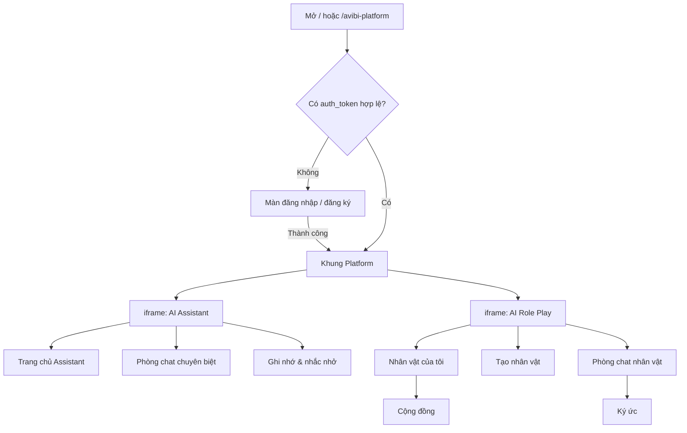

# Màn hình và luồng chức năng — Avibi Platform

Tài liệu mô tả các màn hình, chức năng và luồng xử lý của frontend **theo đúng code hiện tại**:

- `frontend/src/main.tsx`: điểm vào, điều hướng và toàn bộ AI Role Play.
- `frontend/src/assistant/AssistantApp.tsx`: khung Platform, màn đăng nhập và AI Assistant.
- `frontend/src/admin.ts`: Admin CMS.

> Giao diện dùng design system của "Avibi Platform Prototype": token và thành phần cơ bản nằm trong `frontend/src/design-system.css` (màu nhấn theo ứng dụng qua `:root[data-app]`), bố cục từng màn hình nằm trong `frontend/src/redesign.css`. Lần đổi giao diện này chỉ thay CSS và markup trình bày; luồng, màn hình và API mô tả dưới đây không thay đổi.

---

## 1. Bức tranh tổng thể

Sản phẩm gồm **một khung (shell) Platform** chứa **hai ứng dụng con chạy trong iframe**, cộng với **Admin CMS** tách riêng.

| Thành phần | URL | Code | Ghi chú |
|---|---|---|---|
| Khung Platform (gồm cả màn đăng nhập) | `/`, `/avibi-platform` | `AssistantApp` với `landingOnly` | Sidebar chung, quản lý tài khoản, chứa các iframe |
| AI Assistant (trong iframe) | `/ai-assistant?workspace=1` | `AssistantApp` | Hỏi đáp và 4 phòng chat chuyên biệt |
| AI Role Play (trong iframe) | `/role-play-ai?workspace=1` | `RolePlayApp` trong `main.tsx` | Nhân vật AI, chat 1-1 và chat nhóm |
| Admin CMS | `/admin` | `admin.ts` + `admin.html` | Bảo vệ bằng HTTP Basic (`DOCS_USERNAME` / `DOCS_PASSWORD`) |

### Quy tắc định tuyến (cuối `main.tsx`)

- Có `?workspace=1`: `/role-play-ai` render `RolePlayApp`, `/ai-assistant` render `AssistantApp`. Đây là chế độ nhúng trong iframe.
- Không có `workspace=1`: luôn render khung Platform, và URL được đổi thành `/avibi-platform` (`history.replaceState`).
- Backend làm tương tự: `/role-play-ai` và `/ai-assistant` không có `workspace=1` sẽ bị redirect 302 về `/avibi-platform`.

Vì vậy người dùng cuối luôn đi qua khung Platform. Hai app con chỉ hiện trong iframe.

---

## 2. Màn hình đăng nhập / đăng ký

**Code:** `AssistantApp.tsx`, nhánh `if (!account)`.

### Thành phần

- Logo "AI", tiêu đề "Avibi Platform".
- Ô chọn **Language**, hỗ trợ hơn 60 ngôn ngữ (`UI_LANGUAGES` trong `i18n.ts`).
- Ô "Tên hiển thị" (chỉ khi đăng ký), "Tên đăng nhập", "Mật khẩu".
- Nút **Đăng nhập** / **Tạo tài khoản**, và liên kết chuyển qua lại "Chưa có tài khoản? Đăng ký" / "Đã có tài khoản? Đăng nhập".
- Nút **◐ Sáng/Tối** ở góc trên phải.
- Trang trí tương tác:
  - Theme sáng: 4 chim sẻ. Theme tối: cú mèo; bấm vào cú thì cú bay đi, 10 giây sau quay lại.
  - **Nút đèn pin** trong ô mật khẩu: bật đèn rồi rê chuột để "soi" thấy mật khẩu dưới vùng sáng.

### Luồng

1. Khi mở trang: đọc `preferred_theme` để đặt theme. Nếu không có `auth_token` thì hiện màn đăng nhập.
2. Nếu có token: gọi `GET /v1/auth/me`.
   - Thành công: vào khung Platform, áp dụng ngôn ngữ và theme của tài khoản.
   - Lỗi 401: xóa token, quay lại màn đăng nhập.
   - Lỗi khác: báo "Không kiểm tra được phiên đăng nhập…".
3. Bấm Đăng nhập hoặc Tạo tài khoản: `POST /v1/auth/login` hoặc `POST /v1/auth/register` với `{ username, password, display_name }`.
4. Thành công:
   - Lưu `auth_token`.
   - `PATCH /v1/auth/me` để ghi ngôn ngữ và theme đang chọn trên màn đăng nhập vào tài khoản.
   - Tải lịch sử chat Assistant.
5. Lỗi: hiện thông báo đã dịch theo mã lỗi (400/403/409/422/503 hiện nguyên chi tiết từ server; 401, 413, 429/503 có câu chuẩn).
6. Đổi ngôn ngữ ở đây sẽ dịch giao diện ngay (xem [mục 7](#7-đa-ngôn-ngữ-theme-và-đồng-bộ-giữa-các-iframe)).

> `RolePlayApp` cũng có một màn đăng nhập riêng (đơn giản hơn), nhưng thực tế chỉ hiện khi iframe Role Play không có token. Luồng bình thường luôn đăng nhập qua màn ở trên.

---

## 3. Khung Platform (shell)

**Code:** `AssistantApp.tsx`, nhánh `if (landingOnly)`.

### Bố cục

**Sidebar trái:**
1. Logo **Avibi Platform** (link về `/`).
2. Nhóm **Không gian**: **AI Assistant** và **AI Role Play**. Mục đang mở được đánh dấu.
3. Nhóm thay đổi theo không gian đang mở:
   - AI Assistant, nhóm **Tác vụ trợ lý**: AI Assistant, Tâm lý, Sức khỏe, Học tập, Tarot & Tử vi.
   - AI Role Play, nhóm **Nhân vật**: Nhân vật của tôi, Tạo nhân vật, Tạo bản sao, Sáng tạo.
4. **Gần đây**: lịch sử chat của không gian đang mở, mới nhất ở trên, mỗi dòng có nút **×** để xóa (có hộp xác nhận).
   - Assistant: danh sách từ `GET /v1/assistant/chats`.
   - Role Play: danh sách phòng từ `GET /v1/rooms`.
   - Nếu tải lỗi thì hiện nút "Không tải được lịch sử. Thử lại".
5. Nút **Ghi nhớ & nhắc nhở**: mở panel ghi nhớ của AI Assistant.
6. Thẻ tài khoản (avatar, tên, @username) và nút **‹ / ›** để thu gọn hoặc mở rộng sidebar. Trạng thái thu gọn lưu ở `avibi_workspace_collapsed`.

**Vùng nội dung:** chứa tối đa 2 iframe (một cho Assistant, một cho Role Play). Lần đầu mở mỗi app thì hiện màn chờ "AI · Avibi Platform".

### Menu tài khoản (bấm thẻ tài khoản; Esc hoặc bấm ra ngoài để đóng)

- **Hồ sơ** và **Đổi mật khẩu**: mở hộp thoại Tài khoản.
- **Giao diện: Sáng/Tối**: đổi theme, `PATCH /v1/auth/me { theme }`.
- **Ngôn ngữ**: `PATCH /v1/auth/me { language }`.
- **Đăng xuất**: `POST /v1/auth/logout`, xóa token rồi về `/`.

### Hộp thoại Tài khoản (2 tab)

- **Hồ sơ:**
  - Đổi avatar: `POST /v1/auth/me/avatar`, chấp nhận PNG/JPEG/WEBP/GIF.
  - Tên đăng nhập: chỉ đọc.
  - Tên hiển thị (tối đa 80 ký tự), Giới thiệu (tối đa 500 ký tự).
  - **Lưu hồ sơ**: `PATCH /v1/auth/me`.
- **Mật khẩu:**
  - Mật khẩu hiện tại, mật khẩu mới (ít nhất 6 ký tự), ô "Hiện mật khẩu".
  - **Đổi mật khẩu**: `PATCH /v1/auth/me { current_password, new_password }`.
- Sau khi lưu, shell ghi `avibi_account_refresh` vào localStorage để các iframe tải lại thông tin tài khoản.

### Cơ chế điều hướng iframe (`navigateWorkspace`)

1. Nếu iframe của app đích đã tải xong: gửi `postMessage({ type: "avibi-workspace-navigate", path })` để app con tự chuyển màn, không tải lại trang.
2. Nếu chưa có: nạp iframe vào ô trống.
   - Role Play mặc định nạp `view=characters`.
   - Khi iframe báo `avibi-workspace-ready`, shell chuyển sang hiện iframe đó, rồi gửi lệnh điều hướng tới đúng đích.
3. Khi app con đổi lịch sử chat, nó gửi `avibi-workspace-history-updated` để shell tải lại mục "Gần đây".
4. Shell chèn CSS vào iframe để **ẩn sidebar riêng của app con**. Trong workspace, mọi điều hướng chính đều nằm ở sidebar của shell.

### Nhắc nhở định kỳ

Shell gọi `GET /v1/assistant/reminders/due` mỗi 15 giây (nếu bật "Thông báo trên client"). Khi có nhắc đến hạn:
- Hiện toast "Đến giờ rồi" ở vùng nội dung.
- Nếu trình duyệt đã cấp quyền thì bắn thêm Notification hệ thống.

---

## 4. AI Assistant

**Code:** `AssistantApp.tsx`, phần render cuối (sau `landingOnly`). Chạy trong iframe `/ai-assistant?workspace=1`.

### 4.1. Năm chế độ (mode)

| Mode | Tiêu đề | Mô tả ngắn | Tên phòng |
|---|---|---|---|
| `assistant_general` | AI Assistant | Hỏi mình bất cứ điều gì | AI Assistant |
| `assistant_psychology` | Tâm lý | Lắng nghe và cùng bạn gỡ rối cảm xúc | Tư vấn tâm lý |
| `assistant_health` | Sức khỏe | Thông tin sức khỏe thận trọng, dễ hiểu | Tư vấn sức khỏe |
| `assistant_homework` | Học tập | Giải thích từng bước từ tài liệu của bạn | Hỗ trợ bài tập |
| `assistant_tarot` | Tarot & Tử vi | Gửi Bát Tự, lá số hoặc trải bài minh họa | Tarot và chiêm nghiệm |

Mỗi mode chuyên biệt có thêm một câu slogan và một lời chào riêng.

### 4.2. Trang chủ Assistant (chưa có tin nhắn, mode chung)

- Khung soạn tin ở trên, placeholder "Hỏi mình bất cứ điều gì…".
- Lưới **Phòng chat chuyên biệt** gồm 4 thẻ (Tâm lý, Sức khỏe, Học tập, Tarot & Tử vi). Mỗi thẻ có icon, tên, mô tả và liên kết "Mở phòng chat →" (hoặc tên phòng nếu đã có).
- Bấm thẻ: mở phòng chat chuyên biệt.

### 4.3. Phòng chat chuyên biệt

- **Mở từ:** sidebar shell (nhóm Tác vụ trợ lý) hoặc thẻ ở trang chủ.
- **Mỗi lần mở là tạo phòng mới:** `POST /v1/assistant/chats { mode }`, phòng mới được thêm vào đầu danh sách "Gần đây".
- **Phần đầu phòng:** icon, nhãn "Phòng chat chuyên biệt", tên mode, slogan, mô tả. Khi chưa có tin nhắn thì có thêm lời chào của mode.
- **Mode Tarot:** luôn có dòng lưu ý "Nội dung chỉ để tham khảo và chiêm nghiệm…", và placeholder đổi thành "Gửi Bát Tự, lá số minh họa…".

### 4.4. Khung soạn tin (composer)

- **Model:** ô chọn model, chỉ hiện khi `GET /v1/assistant/models?mode=…` trả về danh sách.
- **Nguồn tri thức của phòng:** các file đã tải lên phòng (📚 tên file), mỗi file có nút × để xóa (`DELETE /v1/assistant/chats/{id}/files/{fileId}`).
- **File đang đính kèm:** (📎 tên file), có nút × để bỏ.
- **Ô nhập:** Enter để gửi, Shift+Enter để xuống dòng.
- **📎 Gửi file:** chấp nhận `.txt .md .pdf .docx .pptx .csv .xlsx .jpg .jpeg .png .webp .gif`.
- **Nhãn mode hiện tại** và **nút gửi ↑**.

### 4.5. Luồng gửi tin nhắn (`send`)

1. Nếu chưa có phòng: tạo phòng mới với mode hiện tại (`POST /v1/assistant/chats`).
2. Nếu có file: tải lên `POST /v1/assistant/chats/{id}/files` (multipart). Nếu chỉ có file mà không có chữ, nội dung gửi đi mặc định là "Hãy phân tích nội dung trong tệp tôi vừa gửi."
3. Hiện tin nhắn của người dùng ngay, kèm nguồn file nếu có. Các gợi ý cũ bị ẩn đi.
4. Gọi `POST /v1/assistant/chats/{id}/messages/stream` với `{ message, attachment_ids, model_id }` và nhận SSE:
   - `delta`: nối thêm chữ vào câu trả lời đang stream.
   - `done`: thay bằng tin nhắn hoàn chỉnh (có `sources` và `suggestions`).
   - `partial`: câu trả lời dở dang, gắn cờ `interrupted`.
   - `error`: báo lỗi.
5. Trong lúc chờ (chưa có chữ nào) hiện "Đang suy nghĩ…".
6. Đổi phòng hoặc gửi tin mới sẽ hủy stream cũ (AbortController + số thứ tự stream).

### 4.6. Hiển thị tin nhắn

- **Nhãn người gửi:** "Bạn" hoặc tên mode.
- **Tin của người dùng:** có nút **Lưu vào trí nhớ**, bấm thì mở panel ghi nhớ và điền sẵn nội dung (tối đa 500 ký tự).
- **Câu trả lời bị gián đoạn:** hiện "Câu trả lời bị gián đoạn" và nút **Thử lại**. Thử lại sẽ gửi lại câu hỏi trước đó; nếu câu đó có file thì tải lại file gốc từ `…/files/{id}/content` rồi gửi lại.
- **Nguồn trích dẫn:** dạng `[1] tên file · vị trí`.
- **Gợi ý trả lời:** chỉ hiện dưới câu trả lời cuối cùng; bấm vào là gửi luôn.

### 4.7. Panel Ghi nhớ & nhắc nhở

**Mở từ:** nút ở sidebar shell (`?panel=memory`) hoặc nút "Lưu vào trí nhớ".

**Trí nhớ của bạn:**
- Ô đồng ý "Cho phép AI Assistant ghi nhớ điều bạn chủ động lưu": `PATCH /v1/assistant/memory { enabled }`.
- Khi đã bật:
  - Ô thêm ghi nhớ (tối đa 500 ký tự). Chỉ lưu được khi đang mở một cuộc hội thoại, vì ghi nhớ gắn với phòng đó: `POST /v1/assistant/memory/items { content, room_id }`.
  - Danh sách ghi nhớ của phòng, mỗi mục có Sửa / Lưu / Hủy / Xóa (`PATCH` / `DELETE /v1/assistant/memory/items/{id}`).
  - Nút **Tắt và xóa mọi trí nhớ**.

**Nhắc nhở:**
- Ô "Thông báo trên client": bật thì xin quyền Notification của trình duyệt; lưu ở `assistant_client_notifications`.
- Tạo nhắc: nội dung (tối đa 200 ký tự) và ngày giờ (không được chọn giờ đã qua): `POST /v1/assistant/reminders`.
- Mỗi nhắc nhở có: **Tạm dừng / Bật lại**, **Hoàn tất**, **Xóa** (`PATCH` / `DELETE /v1/assistant/reminders/{id}`).
- Nhắc nhở chỉ hiện khi ứng dụng đang mở.

Dữ liệu panel lấy từ `GET /v1/assistant/memory?room_id=…`, tải lại mỗi khi đổi phòng.

### 4.8. Điều hướng từ shell vào Assistant

| Lệnh từ shell | Kết quả |
|---|---|
| `mode=assistant_general` hoặc không có mode | Cuộc trò chuyện mới, về trang chủ Assistant |
| `mode=<mode chuyên biệt>` | Tạo và mở phòng chuyên biệt mới |
| `chat=<id>` | Mở phòng đã có, tải `messages` và `files` của phòng |
| `panel=memory` | Mở panel Ghi nhớ & nhắc nhở |

### 4.9. Khi chạy độc lập (không có `workspace=1`)

Code vẫn còn giao diện độc lập, gồm:
- Sidebar riêng: Trang chủ, Cuộc trò chuyện mới, Ghi nhớ & nhắc nhở, Tác vụ, Gần đây, link AI Role Play, Đăng xuất.
- Header có ô chọn ngôn ngữ và nút Sáng/Tối, cùng nút ☰ trên mobile.

Do định tuyến ở mục 1, người dùng thường không thấy giao diện này.

---

## 5. AI Role Play

**Code:** `RolePlayApp` trong `main.tsx`. Chạy trong iframe `/role-play-ai?workspace=1`.

Trạng thái `page` có 7 giá trị: `home`, `discover`, `characters`, `create`, `rooms`, `chat`, `memories`. Giá trị ban đầu lấy từ `?view=`.

### 5.1. Dữ liệu tải khi vào app (`refresh`)

Gọi song song 5 API:
- `GET /v1/characters`: nhân vật của tôi.
- `GET /v1/presets`: nhân vật hệ thống.
- `GET /v1/rooms`: các phòng chat.
- `GET /v1/public/characters`: nhân vật cộng đồng.
- `GET /v1/home-sections`: danh mục trang chủ do admin tạo.

Nếu ngôn ngữ khác tiếng Việt, mô tả và lời giới thiệu nhân vật được dịch qua `/v1/i18n/translate` (có cache).

### 5.2. Thanh trên cùng (mọi trang trừ chat)

- Ô tìm kiếm "Tìm nhân vật hoặc cuộc trò chuyện", lọc theo tên, mô tả, loại và tag.
- Nút Sáng/Tối và nút tài khoản (mở Cài đặt cá nhân) **chỉ hiện khi chạy độc lập**. Trong workspace, hai việc này do shell đảm nhận.
- Thông báo lỗi và thông báo thành công hiện ngay dưới thanh. Bấm để đóng; thông báo thành công tự ẩn sau 4 giây.

### 5.3. Nhân vật của tôi (`characters`) — màn mặc định trong workspace

**Mở từ:** sidebar shell "Nhân vật của tôi" hoặc "AI Role Play".

- **Tiêu đề:** "AI Role Play", eyebrow "AI ROLE PLAY".
- **Tab:** **Nhân vật của tôi (số lượng)** và **Cộng đồng** (chuyển sang trang Cộng đồng).
- **Nút tạo:** **Tạo nhân vật** (preset), **Tạo bản sao** (mirror), **Sáng tạo** (custom).
- **Bộ lọc:**
  - Nguồn: Tất cả / Nhân vật hệ thống / Nhân vật của bạn.
  - Hiển thị: Tất cả / Riêng tư / Công khai.
  - Loại: lấy từ `character_type`, `primary_role` hoặc `category`.
  - Kèm số lượng nhân vật sau khi lọc.
- **Thẻ nhân vật:**
  - Ảnh, tên, nguồn (Nhân vật hệ thống / Công khai / Riêng tư), loại, số người dùng, mô tả, nhãn "AI simulation" nếu có.
  - **Trò chuyện**: nhân vật hệ thống đi theo `addPreset`, nhân vật của mình đi theo `startCharacterChat`.
  - Chỉ nhân vật của mình mới có thêm:
    - Thanh cảm xúc ❤️ 😂 🔥 👍 😮: `PUT /v1/characters/{id}/reaction`.
    - **Ký ức**: mở trang Ký ức của nhân vật.
    - **Xóa nhân vật công khai / riêng tư**: có xác nhận, `DELETE /v1/characters/{id}`. Phòng 1-1 với nhân vật đó cũng bị xóa khỏi danh sách.

### 5.4. Cộng đồng (`discover`)

- **Tiêu đề:** "Khám phá nhân vật public".
- **Tab lọc:** Tất cả, Đồng hành, Học tập, Công việc, Giải trí, Role play (khớp các từ roleplay/fantasy/adventure/drama), kèm số kết quả.
- **Thẻ nhân vật public:**
  - Ảnh, loại, tên.
  - Người tạo và số người theo dõi; nút **Theo dõi** (`PUT /v1/public/creators/{id}/follow`).
  - Điểm sao (số lượt đánh giá) và số người đã dùng.
  - Thanh cảm xúc.
  - Mô tả và tag.
  - **Đánh giá 1–5★**: `PUT /v1/public/characters/{id}/rating`.
  - **Thêm vào nhân vật của tôi**: `POST /v1/public/characters/{id}/clone`, sau đó chuyển về Nhân vật của tôi.
- Không có kết quả thì hiện "Chưa có nhân vật public phù hợp."

### 5.5. Tạo nhân vật (`create`) — 4 tab

**Mở từ shell:** "Tạo nhân vật" (`createMode=preset`), "Tạo bản sao" (`mirror`), "Sáng tạo" (`custom`).

**a) Có sẵn (preset)**
- Nhân vật hệ thống chia theo vai trò: Đồng hành, Học tập, Công việc. Mỗi nhóm hiện số lượng.
- Thêm nhóm **Giải trí** (nhãn số lượng đang ghi cứng "3 nhân vật").
- Mỗi thẻ có ảnh, vai trò, tên, lời giới thiệu và thế mạnh.
- Nút **Thêm nhân vật**, đổi thành "Đã thêm" khi đã có.

**b) Tự sáng tạo (custom)**
- **Các trường:**
  - Avatar (tùy chọn).
  - Tên nhân vật.
  - Mô tả tính cách, có đếm ký tự. Trên 6000 ký tự thì AI tóm tắt có cấu trúc trước khi tạo.
  - Ô "Đây là nhân vật trong phim hoặc hoạt hình?". Bật thì hiện thêm "Tên nhân vật" và "Tên phim / hoạt hình"; AI sẽ tham khảo nguồn công khai.
  - Vai trò.
  - Loại nhân vật: Đồng hành, Học tập, Công việc, Giải trí, Tình cảm, Role play.
  - Tags (tối đa 8, chọn từ gợi ý hoặc gõ rồi nhấn Enter).
  - **Công khai nhân vật**.
  - Bối cảnh trò chuyện, Lời chào đầu tiên, Ví dụ cách nói (mỗi dòng một câu, tối đa 8).
- **Nút "Tạo bằng AI":** `POST /v1/characters/generate`. Cần mô tả từ 3 ký tự trở lên.

**c) Bản sao của ai đó (mirror)**
- Tên, ngày sinh (tùy chọn; dùng để thêm kiến thức cung hoàng đạo mang tính tham khảo), mô tả nhân vật, lời giới thiệu đầu tiên.
- **Nút "Tạo phiên bản AI":** `POST /v1/characters/mirror`.

**d) Tạo từ truyện (story)**
1. Tải file truyện (`.txt .md .pdf .docx .pptx`, qua `POST /v1/character-sources`) hoặc dán link (`POST /v1/documents/from-url`).
2. **Tải lên và tìm nhân vật:** kiểm tra `GET /v1/documents/{id}` mỗi 2 giây, tối đa khoảng 3 phút. Khi tài liệu sẵn sàng thì gọi `POST /v1/documents/{id}/discover-characters`.
3. Hiện danh sách nhân vật tìm được (tên, mô tả, trích dẫn). Chọn một nhân vật hoặc tự nhập tên.
4. **Tạo nhân vật từ truyện:** `POST /v1/characters/from-document`.

**Bước hoàn tất chung sau khi tạo (`finishCreatedCharacter`)**
1. `PATCH /v1/characters/{id}/publication` với công khai/riêng tư, loại và tags.
2. Nếu có avatar: tải lên `POST /v1/characters/{id}/avatar`, rồi kiểm tra `…/expressions/status` mỗi 2 giây (tối đa khoảng 10 phút) cho tới khi **bộ 6 ảnh biểu cảm** sẵn sàng.
3. Tải lại dữ liệu, tạo phòng "Trò chuyện với {tên}" và mở luôn màn chat.

Trong suốt quá trình tạo có lớp phủ "Đang hoàn thiện nhân vật…" hoặc "Đang chuẩn bị tài nguyên…".

### 5.6. Trang chủ Role Play (`home`)

- **Tiêu đề:** "Hôm nay bạn cần ai đồng hành?", kèm nút **Tạo phòng nhóm** (sang trang Tạo phòng chat).
- **Các khu vực:**
  - **Nhân vật hệ thống** (hàng ngang): preset không thuộc nhóm Giải trí và không bị admin ẩn.
  - **Nhân vật của bạn**: nhân vật tự tạo.
  - **Các danh mục do admin tạo** (`home-sections`). Mỗi danh mục có một luật lọc:
    - `popular`: theo lượt dùng.
    - `trending`: theo điểm trending.
    - `top_rated`: theo điểm đánh giá.
    - `favorites`: theo tổng lượt cảm xúc.
    - `tags`: khớp tag hoặc vai trò.
  - **Tiếp tục trò chuyện**: các phòng đã có.
- Bấm một nhân vật là bắt đầu chat:
  - Preset: `addPreset`.
  - Nhân vật public của người khác: clone rồi chat.
  - Nhân vật của mình: chat luôn.

> Trong workspace, sidebar shell không có mục dẫn tới trang chủ. App chỉ quay về trang này khi người dùng xóa phòng đang mở.

### 5.7. Tạo phòng chat (`rooms`)

- **Tiêu đề:** "Tạo phòng chat". Chọn 1 nhân vật để chat riêng, hoặc 2–6 nhân vật để chat nhóm (code giới hạn tối đa 6).
- **Bắt đầu chat:** `POST /v1/rooms { character_ids }` rồi mở phòng.
- **Mở từ:** nút "Tạo phòng nhóm" ở trang chủ, hoặc "Lịch sử trò chuyện" trong cột công cụ của màn chat.

### 5.8. Các cách bắt đầu chat với nhân vật

| Hàm | Khi nào | API |
|---|---|---|
| `addPreset` | Nhân vật hệ thống | Nếu chưa có bản của mình: `POST /v1/characters` (copy spec preset). Sau đó `POST /v1/rooms` |
| `startCharacterChat` | Nhân vật của mình | `POST /v1/rooms` |
| `startPublicCharacter` | Nhân vật public của người khác | `POST /v1/public/characters/{id}/clone`, rồi `POST /v1/rooms` |

Mỗi lần bắt đầu là **một phòng mới** tên "Trò chuyện với {tên}". Trong lúc tạo có lớp phủ "Đang chuẩn bị tài nguyên…".

### 5.9. Màn chat (`chat`)

**Mở từ:** "Gần đây" trên sidebar shell (`view=chat&room=…`), hoặc sau khi bắt đầu chat. Khi mở phòng: `GET /v1/rooms/{id}/messages`.

**Cột trái (khung chat):**

- **Header:**
  - Chat 1-1: chân dung biểu cảm lớn của nhân vật. Ảnh đổi theo cảm xúc của câu trả lời mới nhất (neutral, happy, sad, angry, surprised, shy), lấy từ `GET /v1/characters/{id}/expression/{emotion}`.
  - Tên phòng và danh sách thành viên.
- **Tin nhắn:**
  - Tin của bạn: bong bóng bên phải.
  - Tin của nhân vật: avatar, tên. Đoạn `**hành động**` được hiển thị kiểu riêng (action beat).
  - Tin dạng tài liệu: 📄 tên file và trạng thái (Đang gửi… / Đã gửi / Lỗi!).
  - Tin của nhân vật có thêm:
    - **▶ Nghe**: tạo giọng nói qua `POST /v1/roleplay/messages/{id}/speech` rồi phát. Trạng thái đổi thành "◌ Đang tạo", "■ Dừng"; bấm lần nữa để dừng.
    - **↻ Trả lời khác**: `POST /v1/rooms/{room}/messages/{id}/regenerate`, thay câu trả lời và cập nhật biểu cảm.
    - "Nguồn (n)" nếu có trích dẫn.
  - Bị gián đoạn: "Câu trả lời bị gián đoạn. Hãy thử gửi lại."
  - **Gợi ý trả lời** dưới tin cuối của nhân vật; bấm là gửi.
  - Khi nhân vật đang soạn: avatar và ba chấm động.
- **Composer:**
  - Gõ `@` thì hiện nút chọn nhanh tên nhân vật trong phòng.
  - Placeholder "Nhắn gì đó... Gõ @ để gọi nhân vật". Enter để gửi.
  - Ô **người trả lời**: Tự chọn / từng nhân vật / Mọi người (chỉ có ở chat nhóm).
  - Nút **Gửi →**.

**Luồng gửi tin Role Play (`send`):**
1. Hiện ngay tin của người dùng (id tạm `local-…`) và trạng thái "đang soạn" cho nhân vật dự kiến trả lời.
2. `POST /v1/rooms/{id}/messages/stream { message, speaker_mode }` và nhận SSE:
   - `user_message`: thay tin tạm bằng tin thật từ server.
   - `typing`: thêm nhân vật vào danh sách đang soạn.
   - `character_message`: thêm câu trả lời và cập nhật biểu cảm. Gợi ý có thể đến dưới dạng `suggestions_raw = "@@a|b|c"`, và chỉ được dùng khi đủ 3 gợi ý.
   - `character_error` / `error`: báo lỗi.
   - `done`: kết thúc.
3. Nếu stream đóng mà chưa nhận `done`: báo "Phản hồi bị gián đoạn…" và gỡ tin tạm.

**Cột phải (công cụ nhân vật, thu gọn được bằng ‹ / ›; mặc định thu gọn khi màn hình ≤ 820px):**
- Chat 1-1: thẻ hồ sơ nhân vật (ảnh, tên, lời giới thiệu, số người dùng) và thanh cảm xúc kèm số đếm.
- **＋ Cuộc trò chuyện mới**: tạo phòng mới với cùng nhóm nhân vật.
- Menu:
  - **Lịch sử trò chuyện**: sang trang Tạo phòng chat.
  - **Ký ức**: ký ức của nhân vật (chat 1-1) hoặc của phòng (chat nhóm).
  - **Thông tin nhân vật**: sang Nhân vật của tôi.
  - **Tùy chỉnh**: mở Cài đặt cá nhân.

**Xóa phòng:** nút × ở "Gần đây" (có xác nhận), `DELETE /v1/rooms/{id}`. Nếu đang mở chính phòng đó thì quay về trang chủ.

### 5.10. Ký ức (`memories`)

- **Tiêu đề:** "{Tên} nhớ gì?".
- **Thêm ký ức mới** (tối đa 1000 ký tự):
  - Của nhân vật: `POST /v1/characters/{id}/memories`.
  - Của phòng: `POST /v1/rooms/{id}/memories`.
- **Mỗi ký ức:** sửa trực tiếp, rồi **Lưu** / **Ghim – Bỏ ghim** / **Xóa** (`PATCH` / `DELETE /v1/memories/{id}`).

### 5.11. Cài đặt cá nhân (lớp phủ)

**Mở từ:** "Tùy chỉnh" trong màn chat, hoặc nút tài khoản khi chạy độc lập.

- **Hồ sơ công khai:** đổi avatar, tên đăng nhập (chỉ đọc), tên hiển thị, giới thiệu, **Lưu hồ sơ**.
- **Tài khoản:** "Gói hiện tại: Demo", đổi mật khẩu (mật khẩu mới ít nhất 6 ký tự).
- **Tùy chọn:** Giao diện (Sáng/Tối), Ngôn ngữ, **Giảm chuyển động** (`reduced_motion`, hạn chế animation).
- Nút **Đăng xuất**.

---

## 6. Admin CMS (`/admin`)

**Code:** `admin.ts`, viết bằng HTML thuần, không dùng React. Backend bảo vệ cả trang `/admin` lẫn mọi API `/v1/admin/*` bằng **HTTP Basic** (`docs_auth`). Khi mở trang, CMS tải song song 7 API: overview, settings, access-control, characters, models, database, credentials.

Bố cục gồm sidebar "Role Play CMS" và thanh trên cùng có tiêu đề, phụ đề, nút **Mở AI Role Play** và **↻ Làm mới**.

| Mục menu | Tiêu đề | Chức năng chính |
|---|---|---|
| ▦ Tổng quan | Tổng quan sản phẩm | 5 chỉ số (Người dùng, Nhân vật, Phòng chat, Tin nhắn, Ký ức); 10 nhân vật đầu; tài liệu (sẵn sàng/lỗi); các lượt chạy AI pipeline gần đây (số lớp context, memory, tài liệu) |
| ♙ Truy cập | Quản lý truy cập | Bật/tắt **chế độ bảo trì** (chỉ admin dùng được) và **cho phép đăng ký**; tạo tài khoản admin; danh sách tài khoản với cấp/bỏ quyền admin, tạm khóa/mở khóa (khóa sẽ thu hồi mọi phiên) |
| ☺ Nhân vật | Quản trị nội dung | Tạo nhân vật hệ thống (tên, vai trò, nhóm Hữu ích/Giải trí, ảnh ≤ 5 MB, mô tả, system prompt, lời chào, mã giọng TTS); tạo danh mục trang chủ (tên và tag khớp); sửa từng nhân vật (vị trí trên trang chủ, prompt, scenario, ảnh, goals, behavior rules, giọng TTS, xem trước 6 ảnh biểu cảm); **Tạo ảnh biểu cảm còn thiếu**; bảng phòng chat; bảng tài liệu người dùng |
| ▤ Logchat | Logchat | Log hỏi đáp lọc theo sản phẩm (Role Play / Assistant) và từ khóa: model, fallback, latency, lỗi |
| ◉ Nhật ký hoạt động | Nhật ký hoạt động | Đăng nhập, mở app, dùng chức năng, lỗi HTTP; lọc theo nhóm và trạng thái (thành công / câu trả lời dở / lỗi). Không ghi mật khẩu, token hay nội dung request |
| ◈ Cấu hình AI | AI Role Play | Key gateway dùng chung; key theo API base; thêm model (tên, provider, model ID, logo, API base, key riêng); danh sách model (Cấu hình / Ẩn–Bật / Xóa); cấu hình từng model (prompt theo tác vụ, temperature, max tokens, thời gian chờ gateway, thinking/reasoning, giọng TTS mặc định) |
| ✦ AI Assistant | AI Assistant | Kiểm tra mỗi tác vụ đã có đủ 1 model chính và 2 dự phòng chưa; system prompt chung; model riêng cho Assistant (tên hiển thị, Core Model ID, cho chọn trên client, thinking mode, reasoning effort); tab từng tác vụ (general, psychology, health, homework, tarot, suggestion) để chọn model chính, fallback 1, fallback 2 và prompt riêng |
| ▤ Database | Database Explorer | Xem dữ liệu chỉ đọc theo bảng, lọc theo user ID; mật khẩu, token và key bị che `[REDACTED]` |
| ⚙ Phân công model | Phân công model | Gán model cho từng tác vụ: trả lời, gợi ý (và 2 dự phòng), tạo nhân vật, kiểm duyệt, dự phòng hội thoại (2 lớp), tạo avatar biểu cảm, nhận diện cảm xúc (2 dự phòng), phát giọng nói TTS; bảng trạng thái phân công; **Lưu và áp dụng** |

---

## 7. Đa ngôn ngữ, theme và đồng bộ giữa các iframe

### localStorage

| Key | Ý nghĩa |
|---|---|
| `auth_token` | Token đăng nhập, gửi qua header `Authorization: Bearer …` |
| `demo_user_id` | ID người dùng demo khi chưa đăng nhập (header `X-Demo-User-Id`, chỉ Role Play dùng) |
| `preferred_theme` | `light` / `dark`. `index.html` đọc key này trước khi React chạy để tránh nháy màu |
| `ui_language` | Ngôn ngữ giao diện |
| `assistant_ui_v4:{lang}` | Cache bản dịch giao diện Assistant |
| `avibi_account_refresh` | Mốc thời gian báo các iframe tải lại `/v1/auth/me` |
| `avibi_workspace_collapsed` | Trạng thái thu gọn sidebar shell |
| `assistant_client_notifications` | Bật/tắt nhắc nhở trên client |

Theme, ngôn ngữ và tài khoản được đồng bộ giữa shell và các iframe qua sự kiện `storage`: một nơi thay đổi thì các nơi khác tự cập nhật.

### postMessage giữa shell và iframe (cùng origin)

| Message | Chiều | Ý nghĩa |
|---|---|---|
| `avibi-workspace-ready` | iframe → shell | App con đã đăng nhập xong và sẵn sàng hiển thị |
| `avibi-workspace-history-updated` | iframe → shell | Lịch sử chat hoặc phòng thay đổi, shell tải lại "Gần đây" |
| `avibi-workspace-navigate` `{ path }` | shell → iframe | Chuyển màn trong app con mà không tải lại trang |

### Dịch giao diện

- `vi` và `en` dùng bản dịch có sẵn trong code.
- Ngôn ngữ khác gọi `POST /v1/i18n/translate`, có cache.
- Lần đầu tải một ngôn ngữ mới:
  - Role Play hiện lớp phủ "Đang tải ngôn ngữ…".
  - Assistant hiện "Đang tải…".
- Nội dung tin nhắn gắn `translate="no"` để trình duyệt không tự dịch.

---

## 8. Ghi chú về hành vi hiện tại

Những điểm sau đúng với code hiện tại, ghi lại để tránh hiểu nhầm khi làm tiếp:

1. Mỗi lần mở phòng chuyên biệt của Assistant, hoặc bấm "Trò chuyện" với một nhân vật Role Play, đều **tạo phòng mới** chứ không mở lại phòng cũ.
2. "Lịch sử trò chuyện" trong màn chat Role Play dẫn tới trang **Tạo phòng chat**, không phải danh sách lịch sử. Lịch sử thật nằm ở "Gần đây" trên sidebar shell.
3. Nhãn "3 nhân vật" của nhóm Giải trí trong tab Có sẵn đang ghi cứng.
4. Trong workspace không có lối vào trang chủ Role Play và trang Cộng đồng từ sidebar shell. Cộng đồng chỉ vào được qua tab ở Nhân vật của tôi.
5. Trang Tạo phòng chat chỉ hiện chữ cái đầu tên nhân vật, không có ảnh.
6. Ghi nhớ của Assistant gắn với từng phòng, nên phải mở một cuộc hội thoại rồi mới lưu được.
7. `npm run mock` (`frontend/dev/mock-api.mjs`) chỉ giả lập đủ API để xem giao diện: đăng nhập, danh sách nhân vật/phòng, tin nhắn mẫu. Các luồng stream, tạo nhân vật và admin không chạy với mock.
