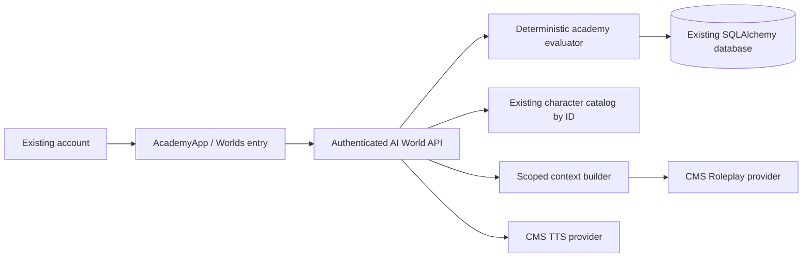

# AI World — demo architecture

## Repository inspection

React 19 / Vite / TypeScript, FastAPI, SQLAlchemy with SQLite by default. Existing bearer session ownership and CMS Roleplay/TTS assignments are reused. GPU workers are untouched. Deployment remains the current Modal web entrypoint or existing self-host entrypoint. No new package, service or database is required.

## Runtime

The previous Lastlight interface is replaced for normal entry. Its database keys remain intact. Legacy APIs remain for compatibility. /worlds/admin now opens dedicated AcademyAdmin; its settings do not control ordinary chat. Ordinary chat and GPU paths are unchanged by this module.

### Files

- character_chat/academy.py: authored world, evaluator, speaker selection, projection, memory ACL.
- character_chat/api/ai_world.py: session authorization, persistence, CAS, moderation, provider adapters.
- character_chat/api/worlds.py: shares catalog and strict moderation helpers.
- frontend/src/worlds/AcademyApp.tsx: world home, scenes, cast, memories, inventory, ending.
- AcademyLandscape.tsx / academy.css: original SVG and CSS atmosphere.
- WorldApp.tsx: route wrapper; old UI used for archived admin only.

## Persistence and logical schema

Demo uses one private, versioned AppSetting JSON aggregate per instance: key ai_world:<uuid>. This is persisted in the same database as other app data and included in its backup. It is not a claim that 17 normalized PostgreSQL tables have been migrated.

| Logical entity | Current aggregate field | Later PostgreSQL mapping |
|---|---|---|
| World / story arc | id, owner, title, language, day, ending | worlds + world_story_arcs |
| Members / scene participants | members (existing IDs), deterministic present() | world_characters + world_scene_participants |
| Locations | authored PLACES + unlocked | world_locations |
| Relationships | user:<id>, pair:<sorted IDs> | world_relationships |
| World / scene / character memory | memories + scenes, witness lists | world_memories + world_scenes |
| Events / activity | events, active_event, last_seen | world_events + world_activity |
| Missions / steps | authored MISSIONS + completed | world_missions + world_mission_steps |
| Timeline | bounded timeline | world_timeline |
| Items / ownership | authored ITEMS + inventory | world_items + world_inventory |
| Secrets / knowledge | server definitions + trust/progress authorization | world_secrets + world_character_knowledge |

Original characters are never cloned. The catalog resolves name, avatar, personality and voice on request. No private ordinary-chat memory is imported implicitly. Up to four existing members, two minimum. Four are selected by default when available.

## API contract

All routes use existing current_user dependency and WORLD_DEMO_ENABLED.

| Method/path | Function |
|---|---|
| GET/PUT /v1/admin/ai-world | Admin-only World prompt, public lore and model selection |
| GET /v1/ai-world | List own instances |
| POST /v1/ai-world | Start academy with character_ids, language, optional title |
| GET /v1/ai-world/{id} | Read own world; bounded return-day scheduler |
| DELETE /v1/ai-world/{id} | Remove only this instance |
| PUT /v1/ai-world/{id}/characters | Set 2–4 available IDs with revision |
| POST /v1/ai-world/{id}/act | revision, request_id, action, value, optional actor |
| POST /v1/ai-world/{id}/speech/{message_id} | Authorized character TTS |

Actions: visit, hint, choice, gift, say. Unknown/locked/repeated actions reject. Revision CAS prevents stale writes. Last 100 request IDs deduplicate successful transitions; a retry returns current state rather than an archived response. Not an exactly-once paid provider contract: concurrent failed chat commits can still incur provider cost. Ten instances per user and 500 gameplay/chat turns per instance are demo caps; visit/hint also check the cap. Memory 120, timeline 120, transcript 60 per place.

## Gameplay and consequences

Three linked missions: letter at library → recover memory in garden → observatory finale. Five items: letter, flower, lens, tea, festival ticket. Gifts are consumed and modify user-character trust/affinity. Reconciliation/confrontation changes both user-character and character-character state. Two finale choices persist different outcomes. No combat or real-time punishment. After chapter completion, conversation and visits remain available.

Ten authored event templates progress by eligibility and completion; no rarity roll or probabilistic event director yet. Opening after 24 hours advances one world day and records one return hook, with no paid calls or continuous simulation.

## Knowledge and context

1. Authenticate instance owner.
2. Resolve selected character from own/public/system catalog; never accept arbitrary requested character data.
3. Determine characters present in the scene.
4. Filter memories and transcript by exact witness membership BEFORE taking the last 10/12 entries.
5. Authorize each secret by trust threshold or committed mission progress; locked text is absent from JSON and LLM input.
6. Add only actor's original persona and applicable relationship records.
7. Call existing CMS Roleplay model, at most two speakers (normally one).
8. Moderate reply before committing.
9. Store all successful dialogue and quoted observation atomically with revision.

Scene presence is authored casting, not geographic simulation: the same member may participate in several scene templates. An unseen conversation is never retroactively visible to a new member. Chat quotations have canon=false and cannot unlock quests or mint items. Canon memories describe validated choices, not model claims. World timeline is visible to the player; that does not make all entries visible to every character.

## Model calls and cost

| Trigger | Purpose / context | Budget | Cache / cheaper alternative |
|---|---|---|---|
| say | Existing Roleplay assignment; persona, 10 witnessed memories, 12 scene lines, unlocked secrets | 400 output tokens per selected speaker; at most 2 serial calls, 20s timeout each | No answer cache; local router costs no tokens |
| moderation | Existing strict world guard; user text and generated replies | Depends on configured JEV / moderation provider | Existing JEV decision cache; provider remains required |
| Listen | Existing CMS TTS assignment, original character voice, stored dialogue | At most 4000 chars, 12MB response, four concurrent audio requests/process | No persistent world TTS cache yet; replay currently generates again |
| navigation/choices/gifts/hints/return hooks | Deterministic authored evaluator | Zero LLM tokens | No LLM necessary |

No offline autonomous calls, generated assets or reflection loop. Chat is currently request/response, not SSE. TTS uses existing CMS voice selection helpers and an audio endpoint adapter, not ordinary MessageSpeech storage.

## Security and operational limits

Private instances only. No publishing, other-human co-play, world asset upload or marketplace. Strict moderation is reused; failure blocks free text. Choices work without provider credentials. No secrets reach frontend config, logs or prompt-visible unauthorized fields.

SQLite JSON aggregates are suitable for this test slice, not a 5000-CCU scale claim. PostgreSQL normalization, indexed owner queries, migrations, durable event jobs and cross-process quota/rate limits require a subsequent production task. Do not silently switch the whole application to PostgreSQL for a visual demo.

## Isolation update

World configuration is stored in ai_world_config separately from instances and ordinary chat. Dialogue adds only World instruction to the static safety baseline, never the editable ordinary-chat ADMIN_RESPONSE_INSTRUCTION. Original character persona remains shared and read-only. Explicit model overrides are optional; blank means inherit provider assignment. See ISOLATION.md for exact boundaries.
